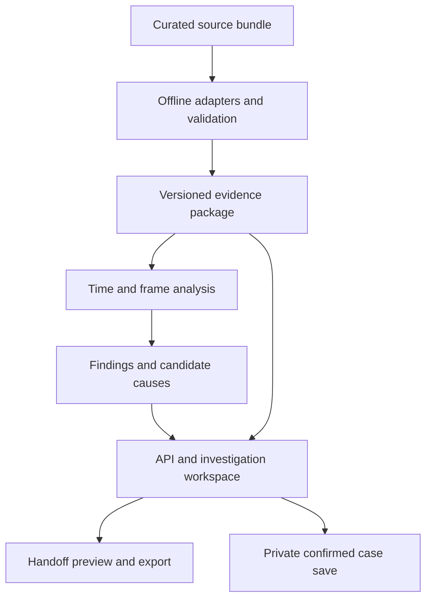
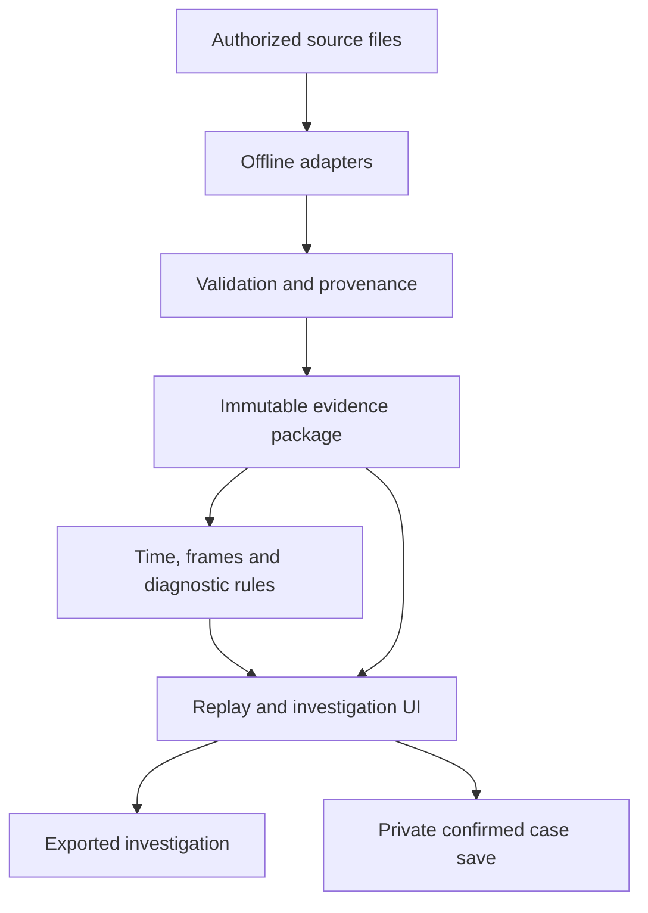

# MaintainAI Robotics V2 — M0 Codex Desktop assignment

**Issued:** November 17, 2026 · America/New_York
**Milestone:** M0 — source recording/import and evidence-contract feasibility
**Status:** Owner-authorized bounded assignment for the V2 Coding workflow. Not an implementation completion report.
**Repository:** `a5ura/MaintainAI_Robotics`
**Planning-verified base:** `f4cbad8565cd4ca3c8da617783b53f62900f6ee4`
**Requested branch:** `feature/v2-m0-evidence-ingestion`
**Actual Codex Desktop workspace/runtime:** Unverified; establish in preflight. This planning workspace is not evidence of Desktop execution or a ROS environment.

## 1. Authorization and instruction precedence

The owner reviewed Planning Draft 0.1 and Design Review 0.2, then said **“ok, I authorize, next.”** Record the reviewed scope and architecture as the working approved product baseline and proceed with this bounded M0 assignment in the companion V2 Coding workflow. Do not ask again for routine implementation choices or actions expressly authorized here.

This assignment permits isolated M0 source/tool/test/documentation changes, ordinary task-scoped dependency setup in an available disposable development environment, a feature branch/worktree, meaningful commits, a push and a reviewable PR. It does not authorize merging, deployment, provider provisioning, billing, V1 database access or later milestones.

The appended documents preserve the original wording and historical approval states. Their earlier “planning only,” “V2 deferred,” “pending approval” and “implementation held” statements are superseded **only to the extent of this approved baseline and M0 assignment**. Proposed numerical performance targets remain unmeasured. Optional/future features are not automatically authorized implementation work.

Read the complete packet, including its appendices, before editing. Also read current repository `AGENTS.md`, `docs/PRD.md`, `docs/DEVELOPMENT_STATUS.md`, `docs/ARCHITECTURE.md` and relevant latest V1 reports. The old repository instruction to defer V2 is superseded for M0 only. This assignment explicitly requests an isolated V2 worktree if the available checkout is shared with V1. Preserve all other applicable repository instructions, especially $0 spending, user-work preservation, required checks and no automatic merge.

## 2. Objective and completion boundary

Prove that a short, genuinely ROS-recorded source can be imported into a traceable, deterministic V2 evidence package, with a minimal controller-fixture and Linux journal-format path. Demonstrate simple time/frame handling against independent expected values.

This establishes the evidence foundation. It does not build the V2 product, full diagnostic engine, UI, private maintenance system or hosting.

**A successful M0 earns these limited claims:**

- A specific ROS distribution/message/storage path was actually recorded and decoded in the documented environment.
- The selected source records can be normalized with provenance, raw timestamps, explicit frame/clock semantics and validation.
- The agreed clock/geometry examples and malformed/degraded-source behavior passed the reported tests.
- Actual dependency, resource and integration limitations are known.

It does not establish physical robot integration, vendor-controller compatibility, production log collection, perception accuracy, live fault detection, deployment or a proven root cause.

## 3. Verified repository context

Planning rechecked remote `main` on November 17 at the SHA above, merge of PR #24. Its tree is `e82b722679751420975a9b599cb100c94d92f00c`. A branch search returned no `v2-m0` match at inspection; recheck before creating anything.

Root `AGENTS.md` was read. The repository's root `pyproject.toml` identifies the historical Cloudflare tooling project and Python >=3.13; it is not the configuration to repurpose for ROS/V2. The native backend has separate dependency manifests. Preserve all of these existing files and dependency environments.

V1 hosting setup continues separately. Do not infer a public URL, completed database initialization or release sign-off from the repository or this authorization. No V2 execution or test result is supplied by this packet.

## 4. Preflight and safe checkout

Before product/source edits:

1. Identify the actual execution host and workspace selected in Codex Desktop. Record OS, CPU/RAM limits where observable, Python/Node/Git versions, available ROS distribution and recorder/reader tools, network/package access and container availability. Do not infer cloud execution from the Desktop interface.
2. Inspect repository identity, remotes, branch, HEAD, clean/dirty status and existing worktrees without printing credentials. Never reset, stash, overwrite, clean or delete another workstream's files to obtain a clean state.
3. Fetch remote `main` and compare it with the planning-verified base. Use the exact verified base for M0 unless a later reviewed base is supplied. If `main` has advanced, identify the new commits and preserve isolation; do not silently rebase this assignment or merge V1 work. A PR may be prepared against current `main` only after its base ancestry/diff remains clean and the base movement is documented for independent review. An unexpected incompatible base change is a stop/report condition.
4. Prefer an existing clean isolated V2 checkout. Otherwise create a separate worktree on `feature/v2-m0-evidence-ingestion` from the verified base, with an unused destination beside the active checkout. This is expressly requested; no additional worktree permission is needed. If that branch/path already exists, inspect and reuse only when it belongs to this assignment and is safe; do not force-move it.
5. Use a task-local output directory and disposable temporary state. Do not load `.env` files, obtain provider credentials, connect to Neon/Render, or use the V1 development/production database. Do not print secret-bearing environment variables.
6. Establish the middleware environment before expanding the adapter implementation. An available supported ROS/Linux pairing is required for the native recording proof. Jazzy on Ubuntu 24.04 is the documented candidate from planning; use a different existing supported pairing only after verifying its official compatibility and recording the decision. Do not upgrade the OS or mix ROS distributions.

Task-scoped package setup in an already available disposable managed Linux environment is allowed within $0. Use isolated Python/tool environments and preserve V1 dependency sets. Do not install WSL, Docker, ROS, GPU drivers or language packs on the user's Windows laptop, create a VM/cloud resource, use a paid runner, or change the host's persistent configuration under this assignment. Existing rootless/container tooling may be used if its availability and boundaries are verified; do not assume privileged Docker exists.

If only the Windows/local context is accessible and the native proof cannot run without those excluded changes, return the concrete access limitation. Do not label another cloud shell as Codex Desktop execution or ask the user to repeat settled product requirements.

## 5. Allowed changes and protected areas

Prefer this bounded layout; adjust new-file organization within these boundaries if the actual repository warrants it:

| Area | Authorized M0 changes |
| --- | --- |
| `v2/` | New standalone evidence schema/validation, adapters, import CLI, time/frame helpers, tests and isolated dependency/lock information |
| `fixtures/v2/m0/` | Small self-authored synthetic source fixtures, genuine captured bag, independent oracle specification, manifests and necessary normalized examples |
| `docs/v2/` | Approved-context copies with this authorization overlay, M0 scope/contracts/run instructions, decision log, resource/test evidence and completion report |
| Root `AGENTS.md` | One focused addition pointing to the authorized M0 scope and V2 documents; retain historical sections and V1 rules |

Protect existing `frontend/`, `backend/`, `cloudflare/`, `postgres/`, legacy `scripts/` and legacy scenario/kinematics fixtures. Do not modify V1 APIs, rule behavior, FK, guide controllers, ticket/reconciliation semantics, schemas, migrations or persistence adapters. Preserve root/frontend/backend dependency manifests and lockfiles, root packaging, CI/workflows, `render.yaml` and provider configuration.

Keep the V2 module independent of `backend.app`, repository initialization and hosted entry points. No API registration or app startup is needed for M0. Use temporary test paths and a guard database path for any required existing backend tests.

Commit only necessary generated source evidence. Target a captured bag under 2 MiB; keep all source data synthetic and the complete raw bundle under 64 MiB. Do not add an opaque large archive, Git LFS configuration, dependency caches, virtual environments, private logs or credentials. If capture overhead prevents a small representative fixture, report sizes and reduce recording duration/topic volume without fabricating the recording.

## 6. Native ROS recording and import proof

Use a short isolated ROS graph with generated publishers and the native ROS bag recorder. Restrict middleware discovery to the task's isolated/loopback environment using the supported configuration for the chosen distribution; document the restriction and use a distinct domain. A domain ID alone is not proof of network isolation. Do not discover, subscribe to or publish on physical robot networks.

Use allowlisted task topics with these selected standard types where supported:

- `sensor_msgs/msg/JointState` for the reduced model's synthetic joint readings.
- `tf2_msgs/msg/TFMessage` for dynamic/static frame examples, preserving topic and transform multiplicity.
- `geometry_msgs/msg/PoseStamped` for a synthetic reference/observation example.

Record in MCAP through the native recorder/storage plugin. Document exact topic-to-source mapping, message definitions, ROS/Python/storage versions and capture invocation. Publish no robot motion, service calls or command/control messages. The graph generates evidence only.

Create the independent expected-published-message specification before importing. Record expected topic/type/count/value content independently of the importer. Handle recorder readiness explicitly and report actual capture coverage; do not edit a captured bag to match an expected count. Compare native bag metadata/counts and selected decoded values against the specification. If transport loss occurred, retain the discrepancy and fix/re-run the capture path or report it; do not silently adjust the oracle.

The importer may use the native ROS reader or an evaluated independent MCAP decoder. Calling the same reader through two wrappers is not an independent decoder check. Use independent published-value expectations and native bag metadata; when an alternate decoder is chosen, additionally compare it with the native ROS reader. Disclose shared dependencies and what each oracle actually checks.

Preserve original recorder times and header/source times separately, source artifact hash, topic, exact type/schema and stable original record position. A bag message containing several transforms must identify the original message and transform index so normalized child events retain exact lineage.

Raw recording bytes and wall-clock recorder timestamps may differ between new captures. Require deterministic **re-import of identical accepted source bytes**, not bit-identical recording regeneration. Document deterministic payload generation separately from runtime capture jitter.

Do not replace the native graph/recorder proof with handwritten ROS-like JSON or merely writing an MCAP container. Such files can be format fixtures, but cannot satisfy the native integration acceptance criterion.

## 7. Other source profiles

Implement only small, explicit adapter profiles:

**Controller fixture:** project-defined JSONL covering phase/completion, gripper command/state and a timestamped event. Preserve command versus measured/synthetic observation. Label this as a synthetic project profile; no vendor parser or controller collector is claimed.

**Linux journal format:** a declared JSON export subset containing message/unit identity, source/reception time as available, monotonic timestamp and boot identity. Distinguish journal reception time from source acquisition time. Handle missing fields and supported non-scalar field forms explicitly; reject or report unsupported forms rather than coercing arbitrary arrays/binary values into trusted text or timestamps.

Use synthetic journal-format fixtures. If an actual benign export from a disposable task environment is available, include it only after inspecting/redacting identities and labeling its origin separately. Real journal collection is optional; this task must not read the user's laptop logs or production services. If no systemd exists, report that no live collector was validated.

Image capture, detector output computation and four checkpoint-image generation are outside M0. Preserve their planned schema references without building a perception pipeline now.

## 8. Minimal canonical contract and CLI behavior

Produce a documented versioned contract, validated by code, for these fields:

| Group | Required semantics |
| --- | --- |
| Run/source | Stable run/cell/model/source identity, origin, artifact hashes, source schema/adapter versions, bounded incident window and coverage report |
| Evidence identity | Stable source artifact/record locator; event kind; sequence/ordinal; parent/origin-group lineage |
| Time | Raw header/acquisition and recorder times when available; clock ID/epoch; import time separate from analytical identity; aligned run time or unknown; uncertainty and mapping reference |
| Geometry | Explicit frame IDs, units, transform direction, applicable calibration/version/validity and finite typed values |
| Quality | Valid/present, unknown, invalid or limited source coverage with reasons; no missing value coerced to zero/false |
| Reproducibility | Input/normalization manifest and canonical analytical-content hash, excluding operational import timestamps and display labels |

Represent integer nanoseconds as decimal strings in external JSON. Define negative durations/offsets versus nonnegative absolute timestamps explicitly. Retain nanosecond precision during normalization and limit conversions to the documented boundaries.

Use a minimal import/validate/inspect CLI whose actual invocations are documented after implementation. No HTTP endpoint, public upload handler, API integration or case database is authorized here.

Stage outputs under a task-owned destination; validate before atomically exposing a completed package. Refuse to overwrite an unrelated/existing destination. Re-importing can target a new destination and yield the same canonical analytical content without deleting earlier evidence. Malformed core inputs must leave no misleading complete run; diagnostics/reporting artifacts may still be retained in a clearly incomplete/quarantined location.

Keep these states separate:

1. Import integrity.
2. Per-source/per-comparison coverage and validity.
3. Diagnostic sufficiency, reserved for later rules; M0 does not declare a normal/detected root cause from the run title.

Reject unsupported major schemas, hash mismatches, invalid core identity and structurally unusable required artifacts. Report unsupported optional sources/records, propagate limited coverage, and never silently drop data while declaring complete coverage.

Enforce bounded input before unbounded parsing: raw source bundle <=64 MiB; normalized event/metadata content <=16 MiB; <=10,000 normalized events; <=60 seconds of capture; record payload <=64 KiB for the declared profiles. Use stricter practical fixture sizes where possible. Do not truncate accepted evidence to satisfy limits.

## 9. Time and frame proof cases

Implement only the bounded normalization/geometry helpers needed to prove the contract:

- Declared offset-only clock maps per epoch; preserve raw source order and a separate deterministic aligned-time view.
- Camera-clock-ahead example: a known +250 ms source-clock offset requires the corresponding negative correction after origin alignment. Test the opposite sign too. Unknown maps keep alignment unknown; never pick an offset by fitting a desired diagnosis.
- Preserve source boot/clock epochs; do not align unrelated epochs or treat every out-of-order event as a clock reset.
- Represent uncertainty intervals and a simple “definitely before / uncertain order” comparison for overlapping versus separated intervals.
- Define `T_A_B` as mapping coordinates from B into A. Prove one simple independently calculated translation and one rotation/vector conversion.
- Verify the proposed canonical-to-renderer basis mapping `(x,y,z) -> (x,z,-y)` with independent basis-vector and rotation expectations, without changing V1's renderer/FK.
- Preserve active and reference calibration configurations as separate alternatives. Missing validity/path produces an unavailable comparison; do not overwrite one configuration with another or invent a transform chain.

The full 40 mm diagnostic story, candidate ranking, image processing and 36+8-case diagnostic evaluation belong to later milestones. A small numerical geometry check is appropriate here, but a hardcoded diagnosis is not.

## 10. Acceptance criteria and required evidence

| ID | Criterion | Required evidence |
| --- | --- | --- |
| M0-01 | Correct safe base/worktree/runtime | Remote/base/head identities, execution location and protected-file manifest; no V1 work overwritten |
| M0-02 | Native isolated recording | Actual native capture commands/logs, graph/topic/type inventory, isolation configuration and small generated-data bag |
| M0-03 | Independent fidelity oracles | Expected-published-message specification, native metadata/count inspection and selected value/time comparisons; shared dependencies disclosed |
| M0-04 | Traceable normalization | Every event resolves to artifact hash and original locator; transformed/derived items retain parent references |
| M0-05 | Deterministic import | Two imports of identical bytes/configuration give identical analytical-content hashes and values, with operational metadata separated |
| M0-06 | Additional source profiles | Valid, missing-field and malformed controller/journal profile cases; no vendor/live-collector claim |
| M0-07 | Time semantics | Offset sign in both directions, unknown alignment, epoch separation, arrival disorder and overlapping uncertainty tested |
| M0-08 | Frame semantics | Independent translation/rotation/basis examples, active/reference separation and missing/invalid comparison behavior tested |
| M0-09 | Bounded atomic import | Oversized/malformed/core-hash/path failures do not expose a complete package, overwrite source data or escape task-owned destinations |
| M0-10 | V1 preservation | Existing protected source/config/fixtures unchanged; required V1 backend/frontend/build checks pass or exact blockers reported |
| M0-11 | Resource/dependency evidence | Actual tool/package versions and licenses; capture/import elapsed time, source/normalized sizes, event counts and measured peak memory with method/context |
| M0-12 | Reviewable handoff | Bounded changed-file list, meaningful commits, pushed feature branch/PR when available, documentation and honest completion verdict |

Record each criterion as PASS, FAIL, BLOCKED or NOT TESTED, with a direct evidence pointer. Do not upgrade BLOCKED to PASS because a format-only substitute works. A native capture blocker prevents a full M0 pass, even if contract/unit work is useful.

## 11. Verification plan

Write meaningful tests for source fidelity, contract/time/frame behavior, validation and atomic output. Author independent expected values before implementation where practical. Test duplicate source references without losing distinct repeated observations. Cover unknown/nonfinite values, unsupported schema/type, source hash mismatch, prohibited paths/symlinks, source count limits and record order.

Keep middleware-dependent integration tests explicit. If unavailable, mark them blocked/not tested and run the ROS-independent tests separately; do not hide the missing recording proof behind a skipped-test count.

Run the repository-required checks in appropriate verified environments:

- The new V2 test suite, with native integration results distinguished from pure tests.
- `python -m pytest backend/tests -q`, using temporary database fixtures and an unused guard database path.
- `npm --prefix frontend test`.
- `npm --prefix frontend run build`.
- Git whitespace and exact changed-file/protected-file comparisons against the approved base.

Keep middleware setup and V1 dependency environments separate. The repository's required commands are not permission to rewrite its manifests or upgrade packages until tests pass. Report unavailable runtimes/cached dependencies accurately. The documented real browser smoke check is required if integration changes occur; M0 excludes such changes, so no new browser simulation behavior or native Windows acceptance is claimed. Do not rerun unrelated historical hosting experiments.

Measure one cold import and repeated warm imports with the same bounded fixture; report the sample count and observed ranges rather than extrapolating a p95 from too few samples. This milestone measures feasibility, not the final public-host performance targets. Record actual hardware/runtime constraints and whether measurements include recorder startup. Stop task publishers/recorders afterward without killing unrelated processes.

## 12. Scope exclusions and stop conditions

Not authorized: production frontend/backend integration, diagnosis/candidate engine, public endpoints, maintenance database, fleet/live subscriptions, physical hardware, physics/IK/planning, GPU/perception/LLM inference, provider resources, account/billing changes, deployment, CI pipeline changes, V1 migrations, destructive cleanup, branch deletion, merge or automatic M1 start.

If the native environment is blocked, investigate the specific documented package/network/tool issue using at most two materially different supported $0 paths within the available environment. Do not loop through near-identical failing installations or spend the entire allowance on setup. This is a bounded investigation policy, not a claim that two attempts prove impossibility. Return exact errors, attempted paths and the smallest viable next option. Useful independent contract work may be completed, but report M0 as partial/blocked.

Stop before any excluded cost/environment/data action. Ordinary isolated implementation, fixtures, tests, documentation, commits and the authorized PR do not require repeated permission. Preserve a resumable state if existing Codex access is exhausted; do not buy credits or imply a task resumes automatically.

## 13. Durable repository context

Under `docs/v2/`, store the approved planning/design context with an explicit authorization overlay and this bounded assignment. Preserve original historical wording or label any extracted sections faithfully. Do not replace V1's `docs/PRD.md`, rewrite its acceptance reports or mark future V2 capabilities implemented.

Maintain a V2 decision record containing actual environment/dependency selections, rationale, alternatives rejected and evidence. Clearly distinguish approved product decisions, routine M0 implementation choices and unresolved future decisions.

Keep the current authorization and M0 scope in durable repository documents so the Coding and Planning conversations do not need implicit context synchronization.

## 14. Completion report and PR

Return this structure:

1. **Verdict:** M0 PASS / PARTIAL-BLOCKED / FAIL, with a one-paragraph reason.
2. **Execution:** Codex Desktop interface context, actual local/cloud host, workspace/worktree, OS/CPU/RAM, language/ROS/storage versions; explicitly unknown values.
3. **Git:** repository, fetched main, approved base, merge base, final head, branch, PR URL and exact changed-file manifest. No fabricated PR if access is blocked.
4. **Source proof:** native recording details, input origin, counts/types/values compared, capture discrepancies, independent oracles and their shared dependencies.
5. **Contract:** normalization fields, hashes/provenance, time/frame behavior and malformed/limited coverage policy.
6. **Acceptance table:** M0-01 through M0-12 with status, evidence pointer and limitation.
7. **Verification:** exact commands, tests passed/failed/skipped/blocked, fixture sizes, actual elapsed/peak-memory measurements and methods. Distinguish fresh execution from reused evidence.
8. **Preservation:** protected V1 paths/config/fixtures unchanged; no V1 DB/provider credentials or production data used; no service/deployment/billing/migration change.
9. **Reproduction:** exact working setup/capture/import/inspect/test commands, task-scoped output locations and cleanup performed.
10. **Remaining risks:** no broad ROS/vendor compatibility, physical data, perception, hosting or final UX claim; explicit access blockers if any.
11. **Next recommendation:** bounded M1 proposal for Planning review only; no automatic start.

The PR description should lead with the new behavior and evidence, state limitations, and link the report. Push/open the authorized review PR if access is available. Do not merge. Planning independently verifies actual head/base/manifest and execution evidence before recommending acceptance or another milestone.

## 15. Start instruction for Codex Desktop

> Read this entire M0 assignment and all included appendices, then read the repository instructions and current status documents. Execute only the authorized M0 source recording/import and evidence-contract feasibility work in an isolated V2 checkout. Establish and report the real execution environment, preserve V1 and its database/hosting work, keep spending at $0, validate the native ROS capture path and independent oracles, run the required checks, and return the specified completion report and reviewable PR. Do not merge, deploy, provision services or start M1. Resolve routine implementation choices within this scope without asking again; report genuine environment, cost or scope blockers precisely.

---

# Included planning context

The following appendices provide the full source documents so this file can be handed to Coding on its own. They preserve the original versions; the authorization/scope overlay above controls M0. Read them as product/design context, not authorization to implement every future feature.

| Appendix | Source | SHA-256 of included source bytes |
| --- | --- | --- |
| A | Original V2 planning handoff | `bf86c0160dfa31a51407b35e0b55950ab13b1ed14c9378b1e0bbc8f5b384fb82` |
| B | Planning Draft 0.1 | `c4a910f9430ad557a67a059199e8d8e0d8385139d9c7016ca5b7cd525c0904f0` |
| C | Design Review 0.2 | `eff0000f949288f947493da24d3197e231ba4a5092b563c35f1ff2575838b107` |

---

# Appendix A — Original V2 planning handoff

# MaintainAI Robotics — Project 2 V2 Planning Handoff

**Date:** November 17, 2026 (America/New_York)
**Destination ChatGPT project:** `MaintainAI_Robotics_Project2_V2_Planning`
**Existing project:** `MaintainAI_Robotics_Project2_V1_Planning`
**Purpose:** Transfer continuity from V1 into a separate V2 planning workspace without interrupting V1 deployment or prematurely authorizing V2 development.

## 1. Read this first

You are the independent product planning, architecture, and engineering-review assistant for MaintainAI Robotics V2. The owner wants to use this new project to plan the next major version while Codex Desktop and the V1 Planning project finish V1 hosting. Do not restart V1 or assume that starting this conversation authorizes V2 coding.

**Current status:** V1 feature development and cloud rehearsal are complete; the scoped verdict is CONDITIONALLY READY for a controlled synthetic demonstration. V1 is in B.2 deployment setup, NOT confirmed deployed or publicly released. V2 is a planning initiative only. There is no approved detailed V2 PRD, implementation branch, architecture, schedule, or deployment at this checkpoint. Earlier V1 requirements explicitly deferred real telemetry, robot/ROS integration, advanced motion/perception, advanced diagnostic AI, and broader fleet capabilities to future work. These are candidates, not an already approved all-inclusive V2 specification.

**Immediate task:** Establish a thoughtful V2 product direction and draft a decision-ready product requirements document (PRD) and architecture proposal. The user wants ambitious, substantive planning, not a long repetitive interview. Work through the most important decisions with clearly marked assumptions and recommendations. Planning may proceed in parallel with V1 deployment; implementation requires separate approval.

## 2. Product identity and career objective

MaintainAI Robotics is Project 2 in the owner's engineering portfolio. Its purpose is to demonstrate evidence-driven robotics operation, failure investigation, troubleshooting, and verified maintenance handoff. The priority is robotics deployment, integration, applications, reliability, and field engineering; applied AI and machine vision are tools supporting those disciplines. It must not become a generic chatbot or a visually impressive but unsubstantiated dashboard.

Original motivating story: a robot performs pick-and-place with pre-pick, post-pick, pre-place and post-place verification. When verification fails, the system retrieves relevant controller, middleware and Linux logs, sensor data, calibration timestamps, transforms, and other evidence; identifies plausible explanations; recommends checks; and allows an operator to document an actual verified outcome. The real value is the investigation across independent sources, not simply detecting one alarm.

Primary audience: robotics hiring managers, recruiters, technical interviewers and engineers. Build for first-time insight within a minute, a coherent 3–5-minute demo, and deeper inspection of technical decisions and correctness. A future operator-facing system is a design hypothesis; do not claim production adoption or safety certification.

### Portfolio relationships

- **Project 1 — MaintainAI:** https://github.com/a5ura/MaintainAI. Separate completed Python/Streamlit/SQLite maintenance management proof-of-concept. Equipment/issue/history records, local MiniLM semantic retrieval, deterministic patterns, guided troubleshooting and optional consent-gated cloud generation. Historically reported 909 passing tests. The owner rated its UI poorly (0/10); do not transplant that UI. Its maintenance, historical evidence and retrieval concepts can inform V2 if justified.
- **Project 2 V1 — MaintainAI Robotics:** https://github.com/a5ura/MaintainAI_Robotics. React/3D robot simulation, actual backend diagnostic computation, maintenance records and Guided Demo. This is the foundation to preserve, not an abandoned prototype.
- **Project 2 V2:** Proposed evolution of Project 2. The new ChatGPT project is an organization boundary, not authorization to create a separate GitHub repository, fork, or change the existing main branch. Decide repository/versioning and integration strategy in the V2 plan; prefer preserving a stable V1 release and reusing tested contracts where appropriate.

## 3. V1 verified engineering baseline

Repository: `a5ura/MaintainAI_Robotics`
Last independently verified merged commit in V1 Planning: `f4cbad8565cd4ca3c8da617783b53f62900f6ee4` (PR #24, documentation-only hosting report). This is a historical checkpoint, not a claim that no newer commits exist. Verify current main and authorized deployment progress before relying on it for a future coding assignment.

### Implemented product behavior

- Browser-owned independent simulation clock/run state, Start/Pause/Reset; deterministic twelve-second pick-and-place cycle. One reduced three-revolute-joint (3R) workcell model; not a commercial robot digital twin, physics simulator or physical control loop.
- Valid cycle plus Dropped Object, Positioning Error, Vision Failure, Unexpected Robot Stop; seeded Random Failure resolves reproducibly. Four simulated verification checkpoints/observations (not captured physical camera images).
- Actual joint interpolation and forward kinematics computation. Three.js visual transforms and independently implemented Python FK validation agree on golden fixtures. Optional advanced overlays include joint values, frames, executed TCP path, transforms and component inspection. Historical TCP markers are distinct from live robot state.
- FastAPI backend processes the sample payload, verifies input quality and derives fault status, evidence-linked observations, competing hypotheses, support/contradiction and recommended operator checks. It does not accept the selected scenario name as the diagnosis. Rule scores are not calibrated probabilities. Bad/contradictory/incomplete evidence can yield inconclusive status.
- Equipment registry and diagnosis-linked maintenance tickets; immutable diagnostic snapshots, history, notes, statuses and resolution history; optimistic version checks; saved ticket JSON/Markdown exports, preservation of drafts, request-ID idempotency. Never imply a ticket is proof of a repair.
- Six-stage Guided Demo: Introduction → Robot Operation → Fault Detection → Evidence Investigation → Diagnosis and Next Checks → Maintenance Handoff. Manual default. Automatic advances only when ready plus four seconds; speech completion does not gate progression. Fault pause preserves run identity; Previous does not rewind robot. Hidden tab requires explicit Resume. Exit rather than Skip. Browser speech with visible captions and fallback; no paid narration API.
- Explicit ticket preview and separate confirmation; Cancel/Escape/navigation/Automatic mode cannot create a ticket. Same-page uncertain requests can reconcile using the same UUID and immutable payload after explicit reconfirmation. No reload recovery or global cross-tab deduplication guarantee.

### Existing engineering example: Dropped Object

Seed 42 is the controlled recruiter story. Evidence E5: object present, vacuum magnitude 65 kPa, HOLD. E6: object absent, 12 kPa, HOLD. E11: independent target absence. Evidence supports investigating vacuum seal/supply loss while commanded HOLD contradicts premature release; sensor error remains a competing explanation. The operator must check the actual cause. The stationary hold test is suggested, not completed. All these inputs are synthetic, not a hardware incident; rank is not a validated probability. Use this story as a V2 regression anchor and contrast it with a richer evidence-driven scenario.

### Technical baseline

| Layer | V1 implementation |
|---|---|
| UI | React, TypeScript, Vite, Tailwind, React Three Fiber / Three.js |
| Robot model | Reduced 3R, predefined smooth joint-space knots/interpolation, FK; no IK/physics controller |
| API / diagnostics | Python, FastAPI, Pydantic, deterministic evidence-correlation and rule registry |
| Evidence | Typed samples/events with time, phase, joint/TCP data, gripper/object/vacuum, verification, optional vision/placement/controller signals |
| Local persistence | SQLite, synthetic seed, transactional records |
| Hosted persistence | Native async Psycopg/PostgreSQL adapter; local integration/recovery verified in prior work; hosted durability unverified |
| Hosting target | One same-origin Render Free native Python web service serving compiled React and `/api`, external Neon Free PostgreSQL |
| Narration | Browser-native speech and captions |
| Tests | Frontend unit/integration, pytest backend, Playwright browser; shared kinematics/scenario fixtures |

Important current contract details from the architecture: `/api/diagnose` accepts a bounded sample payload rather than an explicit failure label. Existing model limit is 2,000 samples, request limit 2 MiB; simulated FK agreement tolerance is 0.0001 m, not a physical robot accuracy specification. V2 must deliberately revise assumptions around asynchronous rates, sensor uncertainty, partial evidence, source timestamps and coordinate systems rather than directly applying V1's exact simulated consistency criteria to hardware.

## 4. V1 acceptance, decisions and unresolved deployment

| Checkpoint | PR | Outcome |
|---|---|---|
| GD-02B-1 | earlier merged | Six-stage walkthrough controller |
| GD-02B-2 | #18 | Visual guidance and responsive/accessibility work |
| GD-02B-3 | #19 | Narration synchronization and milestone gating |
| GD-02B-4 | #20 | Operator-confirmed maintenance handoff and reconciliation |
| GD-02B-5 | #21 | Final acceptance audit; CONDITIONALLY READY |
| GD-02C-1 | #22 | Recruiter polish F01–F03 |
| GD-02C-2 | #23 | Fresh cloud rehearsal and deferred Windows checklist |
| Pre-B.2 | #24 | Hosting feasibility; NO-GO on immediate deployment until operational gates |

Latest reported application suites (GD-02C-1): 215 frontend, 98 backend, 72 full Playwright, 8 focused browser; build and configured TypeScript passed. These were Codex-executed results, independently reviewed as evidence, not independently rerun by Planning. C2 reused identical-source regression/resource evidence; fresh Manual Linux Chromium/SwiftShader rehearsal 202.325 seconds, one diagnosis POST, one confirmed ticket and one creation event, zero captured uncaught page errors, successful saved-record navigation. Seven usable screenshots; blank Stage 5 capture excluded. No native Windows hardware, speech, human usability/rehearsal validation, prolonged performance or hosted durability sign-off. Five prior virtual-time runs showed stable resource counts but growing GC-assisted heap (about 8.31 to 9.36 MiB); not proof of no leak. F04 dense raw engineering values remains optional/deferred.

### Parallel V1 hosting workstream (do not take over in V2)

- Owner reported Render Hobby/Free and Neon Free with no payment method linked; Render dashboard 0/750 free instance-hours, 0/5 GB bandwidth, 0/500 pipeline minutes. Neon monthly usage reported zero compute/storage/history/transfer; earlier dashboard indicated roughly 31 MB storage (different display/context). Do not reconcile these into measured actual DB size without checking. Existing project `maintainai-robotics-v1`, AWS US East 2 (Ohio), production branch, intended `neondb`. Codex/user reported PostgreSQL 17.12 and zero non-system relations; no schema changes at that inspection. Runtime-role result not supplied in this conversation.
- Owner approved B.2 deployment setup within strict $0 and read-only initial release policy. Owner is separately working with Codex Desktop on PostgreSQL client tools; installation and database initialization are not confirmed at this handoff. Laptop is approved as backup destination, but protection, second-copy availability and actual backup/fresh restore remain unverified. No live URL confirmed.
- Published allowances recorded in PR #24: Render Free 0.1 CPU, 512 MB, 750 hours, 5 GB egress, 500 build minutes; idle sleep after 15 minutes. Neon Free 100 CU-hours/project/month, 1 GB/project, up to 2 CU, 5 GB transfer, ten branches, five-minute idle suspension. These are dated terms, not guarantees; verify current actual plans before selecting services. No payment method/paid plan, cap uncertainty, throttling and quota exhaustion can affect availability.
- `DEMO_READONLY=1` on the hosted PostgreSQL app blocks diagnosis POST as well as maintenance POST/PATCH; fresh Guided Demo stalls at Fault Detection. Even GETs can consume database quota counters. Public full-workflow writes need separate approval; existing public budgets (2,000 requests/day, 250 writes/day, 64 MiB/day evidence, 512 MiB write cutoff) are not billing caps or authentication. Shared records can be modified or quota-exhausted by anonymous visitors.
- No public release sign-off, hosted restart/durability/backup recovery, browser GPU/speech acceptance, or portfolio video at handoff. V1 work remains with V1 Planning/Coding. V2 must not alter their database, provisioning, billing, production branch, configuration, or launch schedule.

## 5. Established constraints and V2 decision boundaries

Apply the owner's established preferences unless explicitly revised:

1. Strict $0 incremental spend (no paid APIs, hardware purchases, subscriptions, cloud credits or paid infrastructure; free plans may suspend and still need verification). Existing ChatGPT/Codex access does not imply unlimited usage. Propose a fallback rather than silently weakening cost constraints.
2. Codex Desktop is the implementation interface; actual execution environment must be verified separately. Prefer managed cloud development where practical, with lightweight Windows local work only when necessary and authorized. Laptop: Dell G7 7588, Intel i7-8750H, 16 GB RAM, GTX 1060 Max-Q; actual availability/drivers to be verified. Do not assume ROS 2, GPU compute, physical robots or privileged Docker are available.
3. Exceptional UX, real computation, evidence traceability, explicit epistemic distinctions (observed vs simulated vs computed vs hypothesized vs operator-verified). A compelling technical workflow beats a long feature list. No invented physical measurements, safety proof, validated ML metrics or completed repairs.
4. User prefers practical, concise responses, no emojis, limited clarification, and substantial scoped Codex assignments with tests and PRs. Planning owns decisions and independent review; Coding owns implementation and evidence. Keep durable GitHub records; separate planning/coding conversations are not automatically in sync.
5. V1 approved a no-login public demo with independent simulation sessions and shared persistent synthetic maintenance records. Preserve that stable experience; V2 authentication, isolation, multi-tenancy, retention and real-data access are OPEN decisions. A public synthetic sandbox must never expose private operational data or allow untrusted users to control robots.
6. No deployment, changes to billing, destructive operations, migrations, branch deletion or merge without scope-specific authorization. For V2, do not create a repository, branch, code or contact a real robot until the owner approves the corresponding task.
7. Do not carry the old three-day V1 target forward as a V2 deadline. Estimate milestones only after scope is agreed.

## 6. V2 candidate scope (not approved requirements)

Original V1 PRD explicitly deferred: real ROS 2 subscriptions/topics/bags/TF; controller/pendant and Linux log collectors; live telemetry and robust synchronization; physical hardware integration; perception and advanced simulation/physics/IK/motion planning; advanced ML/AI diagnostic models; production integrations and broader fleet support.

Recommended planning hypothesis: V2 should advance from a self-contained simulated fault demonstration toward a **robotics evidence investigation platform** capable of consuming realistic replayed data and, later where resources and authorization permit, live read-only telemetry. The following capabilities are proposed for discussion and prioritization, not a commitment to build all of them.

| Candidate | What it demonstrates | Key decisions / constraints |
|---|---|---|
| Source adapters | ROS 2 topics, bags, TF; robot/controller events, Linux logs; vision/gripper signals | Define adapter interfaces, source schemas and replay-first fixtures; no claim of vendor compatibility without tests |
| Event ingestion and time alignment | Correlate asynchronous signals through clock offsets, event-time, missing/out-of-order events, deduplication, freshness | Define provenance, tolerances and explicit unknowns; measure against controlled fixtures |
| Workcell model and visualization | Contextual 3D pose, transforms, motion and sensor checkpoints | Decide whether a richer model/URDF, RViz-style inspection, IK, or physics is necessary; preserve performance |
| Fault investigation | Rules-first plus optional retrieval/ML assistance, richer competing causes, multi-source contradictions | Abstention and evaluation; no unsupported probability, AI answer or autonomous repair |
| Vision evidence | Four-stage verification, image metadata, detection results and independently observed placement | Start with reproducible generated or permitted recorded images; evaluate whether real vision pipeline is worth scope |
| Maintenance intelligence | Retrieval of related incidents/manuals, checks, confirmed action, audit trail | Cite source passages; distinguish historical similarity from current cause; no unconsented external API |
| Fleet/multi-cell | Multiple independent robots, filtering, prioritizing incidents | Decide if needed for first V2 demo; bound scale and storage; no fabricated production fleet |
| Predictive maintenance | Trends, degradation, trend-based warning or measured baseline anomaly | Only if data and evaluation justify; do not claim remaining useful life from synthetic labels alone |
| Live integration | Read-only authorized data from actual or simulated ROS 2 environment | No physical hardware guarantee; use isolated simulation/replay alternative, no robot command/control by default |
| Deployment and isolation | Recruiter-ready synthetic demo separate from operator or private data | Free-tier cap, security, backup, isolation, cold-start and data retention decisions |

Suggested comparison: **A. Replay-first diagnostic vertical slice** (recommended starting hypothesis); **B. ROS 2 simulator-first with actual middleware integration**; **C. Full live/fleet/inference platform** (likely later roadmap, subject to resources). Compare on robotics engineering credibility, recruiter impact, risk, time, integration access, UI clarity, reproducibility and strict cost. These approaches can be staged rather than mutually exclusive. Avoid making V2 a mandatory hardware acquisition project.

## 7. V2 planning deliverables and review gates

Produce these as a coherent planning package, using evidence and recording decisions. Current-source research is appropriate for changing technologies, licenses, free tiers and compatibility; do not confuse historical V1 documentation with a current provider guarantee.

- Product brief: problem, audience, success story, differentiation, assumptions and exclusions; candidate comparison and recommended scope.
- V2 PRD: goals, non-goals, personas/user journeys, numbered functional and non-functional requirements with measurable acceptance criteria, scope priorities (must/should/could/defer), explicit V1 compatibility rules and synthetic vs real-data boundaries.
- Technical design: component map and data flow from source adapter to normalized evidence to detection/diagnosis to operator handoff; event-time model, message/evidence schemas, frame conventions, ingestion limits, persistence, restart/failure handling, safety and security. Evaluate costs and development environment before approving dependencies. Distinguish a proposal from tested implementation.
- UX design: default workspace, evidence timeline, fault investigation, maintenance handoff, advanced engineering view, Guided Demo storyline; design for first-time recruiter and engineer drilldown. Include empty/loading/inconclusive/permission/connection states. Keep visual density under control.
- Evaluation and test strategy: deterministic ground truth fixtures; normal/fault/ambiguous/unknown/missing/out-of-order/clock-skew cases; evidence link correctness, false positives/negatives and uncertainty/abstention when justified, latency and resource measurement, security isolation, browser smoke; label benchmark conditions and avoid unsupported metrics. Define human acceptance separately.
- Milestone plan: bounded vertical slices, dependencies, exit conditions, risks and fallback. Identify first milestone with highest evidence-to-effort value, but do NOT send it for implementation until the scope/design is approved. Provide a research/prototype phase if compatibility is uncertain.
- Decision and risk log: each proposed decision, rationale, alternatives, owner approval state, cost impact, evidence and blockers. Include V1 regression and data isolation gates.
- After approval only: exact Codex task packets with approved base/branch, objectives, scope exclusions, requirements, verification and completion report template. Each PR requires independently verified head/base/manifest and approval to merge; no automatic phase start.

### Proposed planning sequence

P0: V1-to-V2 gap analysis and product direction; compare 2–3 realistic approaches.
P1: approve scope and PRD (prioritize one end-to-end story).
P2: architecture, evidence contract, data/simulation sources, security/cost and environment feasibility.
P3: UX and demo journey plus evaluation design.
P4: phased roadmap and first bounded implementation assignment, held pending the owner's authorization and safe V1 boundary.

This sequence is a recommendation, not a locked schedule. The initial planning session should be substantive and may generate a consolidated draft, not just ask questions. Highlight unresolved decisions and what would justify a change of direction.

## 8. Authoritative references for the new project

Read relevant repository files at the verified baseline before claiming implementation specifics. Use the connected GitHub tool if available; otherwise ask the owner for exact source or clearly mark gaps. Some docs contain historical status text, especially `docs/PRD.md` (the original V1 handoff); later merged reports supersede dated checkpoint statements. Do not interpret old proposed Skip controls, pre-coding status or SQLite-hosting assumptions as current implementation.

- [V1 repository at checkpoint](https://github.com/a5ura/MaintainAI_Robotics/tree/f4cbad8565cd4ca3c8da617783b53f62900f6ee4)
- [V1 original PRD](https://github.com/a5ura/MaintainAI_Robotics/blob/f4cbad8565cd4ca3c8da617783b53f62900f6ee4/docs/PRD.md)
- [Architecture](https://github.com/a5ura/MaintainAI_Robotics/blob/f4cbad8565cd4ca3c8da617783b53f62900f6ee4/docs/ARCHITECTURE.md)
- `README.md`, `docs/DEVELOPMENT_STATUS.md`, `docs/DECISIONS.md`, `fixtures/scenarios.json`, `fixtures/kinematics.json`
- [C1 polish report](https://github.com/a5ura/MaintainAI_Robotics/blob/f4cbad8565cd4ca3c8da617783b53f62900f6ee4/docs/GD02C1_COMPLETION_REPORT.md)
- [C2 acceptance report](https://github.com/a5ura/MaintainAI_Robotics/blob/f4cbad8565cd4ca3c8da617783b53f62900f6ee4/docs/GD02C2_WINDOWS_ACCEPTANCE_REPORT.md)
- [Pre-B.2 final hosting verification](https://github.com/a5ura/MaintainAI_Robotics/blob/f4cbad8565cd4ca3c8da617783b53f62900f6ee4/docs/PRE_B2_FINAL_HOSTING_VERIFICATION.md)
- `docs/PHASE_B1_HOSTED_RUNBOOK.md`, `docs/PHASE_B1_CAPACITY_POLICY.md`, `docs/PHASE_B1_SECURITY_REVIEW.md`, `render.yaml` (V1 operational reference only)

This handoff incorporates the original October 31 V1 planning handoff, the repository PRD/architecture/README, merged PR #22–24 review findings, and the owner's November 17 account/setup reports. It does not reproduce credentials or database URLs. Uncommitted B.2 workspace material and local installation progress were not independently accessed. Repository and release state may change; verify before implementation.

## 9. Opening prompt — copy into the new V2 Planning conversation

> We are starting **MaintainAI Robotics Project 2 V2 Planning**. Read the uploaded `MaintainAI_Robotics_Project2_V2_Planning_Handoff.md` as the continuity baseline. V1 functionality has been built and reviewed; the V1 project and Codex Desktop are handling hosting setup separately. Do not interrupt or modify V1. V2 is planning only; no coding, provisioning, deployment, payment or database changes are authorized.
>
> My objective is to turn V1's simulated evidence-driven failure-investigation demo into a much more compelling robotics engineering portfolio project while retaining exceptional UI/UX, genuine computation, explainability and a strict $0 incremental budget. Preserve the previously deferred V2 opportunities, but don't assume all of them must be in the first release.
>
> Start with a concise V1-to-V2 gap analysis, then propose a substantial V2 product direction. Compare replay-first real-format telemetry, ROS 2 simulator-first, and broader live/fleet/AI platform approaches (or better justified alternatives). Evaluate technical credibility, recruiter value, implementation effort, environment/hardware feasibility, safety, and cost. Recommend a focused end-to-end V2 demo story and separate minimum viable scope from future expansion.
>
> Prepare a detailed first-pass V2 planning package: product brief, draft PRD with measurable acceptance criteria, proposed system architecture/data flow and source contracts, UI/UX and Guided Demo journey, diagnostic evaluation and test strategy, risk/decision log, phased roadmap, and candidate first coding milestone. Clearly mark all unapproved decisions and unverified claims. Read relevant repository sources when needed and verify current technical/provider facts before relying on them. Do not give me a long repetitive requirements questionnaire; make reasonable provisional recommendations and identify only the important owner decisions. Stop at a planning review gate. I will approve scope and architecture before authorizing any V2 implementation.

## 10. Project setup

1. Create the separate ChatGPT project `MaintainAI_Robotics_Project2_V2_Planning`.
2. Upload this file to its project files. Optionally attach the V1 PRD and latest merged acceptance reports for offline reference; avoid duplicating historical handoffs as current status.
3. Start a new conversation with Section 9. Keep V1 deployment work in the original V1 project.
4. When an approved V2 coding packet exists, use a companion `MaintainAI_Robotics_Project2_V2_Coding` workspace/Codex Desktop workflow. Establish a reviewed Git baseline and isolation strategy first.

**End of handoff.** V2 planning is authorized by the owner's request; no V2 implementation or V1 operational changes follow automatically.

---

# Appendix B — Planning Draft 0.1

# MaintainAI Robotics — V2 planning package

**Revision:** Draft 0.1 · November 17, 2026 · America/New_York
**Status:** Product and architecture proposal for owner review. No V2 implementation is authorized.
**Continuity baseline:** The complete `MaintainAI_Robotics_Project2_V2_Planning_Handoff.md`, including its opening prompt in Section 9.
**Recommendation:** A replay-first robotics evidence investigation workspace, with a genuine ROS 2 bag import as a release credibility gate and a focused placement-verification investigation as the main demonstration.

All V2 requirements, targets, designs, milestones, and choices below are **proposed and unapproved**. Numerical targets describe acceptance goals, not achieved performance. Existing constraints from the handoff remain established. The example V2 data do not exist yet.

## 1. Starting point and evidence boundaries

Read-only GitHub inspection on November 17 found `main` at **`f4cbad8565cd4ca3c8da617783b53f62900f6ee4`**, matching the handoff checkpoint. Reviewed the original PRD, architecture, README, C1 and C2 reports, relevant hosting-report sections, `backend/models.py`, and scenario-fixture structure. Later reports supersede historical statements in the original PRD and architecture. This review ran no application tests and inspected no signed-in provider accounts, local Codex Desktop environment, or live V1 deployment.

V1 is an implemented foundation with a conditionally ready controlled synthetic demonstration. Hosting remains a separate V1 workstream; this package makes no claim that V1 is publicly deployed. The recorded C1 results are 215 frontend tests, 98 backend tests, 72 full browser cases and 8 separate focused cases. C2 reused those results and added a 202.325-second cloud rehearsal. Those are prior execution results, not new V2 validation or Windows/human acceptance.

The review changed no repository file, branch, database, provider configuration, billing setting, or V1 launch decision. This document is the planning deliverable.

### V1-to-V2 gap analysis

| Area | Established V1 capability | Proposed V2 advance | Portfolio significance |
| --- | --- | --- | --- |
| Evidence origin | Coherent synthetic samples generated from the browser simulation | Import separate source artifacts through tested adapters, retaining original records | Shows integration work beyond an application-owned payload |
| Time | One cycle clock and tightly coupled samples | Source clocks, acquisition versus recording time, offsets, uncertainty and clock epochs | Demonstrates real failure-investigation problems |
| Coordinates | Exact reduced-3R FK consistency in a Y-up simulation | Explicit source frames, time-valid transforms, calibration versions and renderer conversion | Makes frame/configuration errors investigable |
| Diagnosis | Rules correlate signals and rank competing explanations | Separate symptom detection, evidence sufficiency and unresolved causes; handle partial contradictions locally | Shows disciplined reasoning under imperfect evidence |
| Vision | Four simulated observations | Four inspectable image artifacts with acquisition metadata and traceable observations | Makes the original pick-and-place story easier to inspect |
| Investigation UX | Working workcell, timeline, evidence links and engineering overlays | A question-led workspace with synchronized evidence views and clearer source quality | Reduces the effort needed to understand the engineering |
| Maintenance | Immutable diagnoses and persistent tickets with explicit confirmation | Versioned investigation packages, check results and explicit verification provenance | Connects diagnosis to a defensible maintenance handoff |
| Runtime scope | Self-contained demonstration | Offline import plus lightweight replay; live integration reserved for a later gate | Adds credibility within the budget and available hardware |

V2's main product change is **investigation across imperfect sources**. A new robot mesh, more charts, or a chatbot alone would contribute less to that objective.

## 2. Product brief

**Problem.** A failed verification does not by itself establish a robot failure. A deployment engineer must distinguish motion, gripping, perception, timing and configuration problems while preserving the evidence behind each conclusion.

**Product direction.** MaintainAI Robotics helps an engineer reconstruct a failed task from replayed evidence, compare competing explanations, identify the next discriminating check, and export or save a traceable investigation.

**Primary audience.** Hiring managers and technical interviewers evaluating deployment, integration, applications and reliability engineering. Recruiters need an understandable first impression; engineers need reproducible inputs and inspectable computations. A real operator workflow remains a future product hypothesis.

**Value statement.** “When a placement check fails, show what the independent sources agree on, where they disagree, and what must be verified next.”

**Differentiation.** Combine a coherent workcell story with source provenance, time/frame reasoning, competing explanations and a maintenance handoff. Do not claim uniqueness or that commercial observability products lack these capabilities.

**Proposed product success criteria.**

- Within 60 seconds after the workspace becomes interactive, a first-time reviewer can identify the reported symptom, the synthetic/replay boundary and the investigation action.
- A manually paced Guided Demo takes 3–5 minutes and reaches an evidence-linked handoff without presenting a hypothesis as a completed repair.
- An engineer can follow every material finding to the original source record and reproduce the result using the documented dataset, adapter and rule versions.
- The selected fault is inferred from evidence. Changing the case title or expected-answer metadata cannot change the diagnosis.
- The released workflow has a working $0 path, with truthful degraded behavior if a free host is unavailable.

These are proposed acceptance goals. Human comprehension and demo timing require human review; automated browser inspection cannot establish them.

### Provisional assumptions

| ID | Assumption for this draft | What would change the plan |
| --- | --- | --- |
| A1 | One workcell and a short incident window are enough for the first V2 release | A specific interview goal requires multi-robot coordination |
| A2 | No physical robot or private operational dataset is available | Authorized access to useful hardware/data justifies a separately scoped integration |
| A3 | A small isolated Linux ROS 2 recording environment can be made available at $0 | M0 cannot record/read a real bag within available access; revise the ROS claim or approve a different route |
| A4 | The existing React/FastAPI foundation remains suitable | Measured resource or isolation problems require a documented architecture change |
| A5 | Public V2 can use curated synthetic data and export a handoff; persistent editing can initially be private | Owner requires anonymous shared V2 writes; scope must add abuse, retention and durability work |
| A6 | A convincing investigation matters more than a new commercial robot model | Owner explicitly prioritizes a specific model or motion/perception demonstration |

## 3. Approach comparison and recommendation

The assessments below are planning judgments, not measured benchmarks or delivery estimates.

| Criterion | A — Replay-first, real source formats | B — ROS 2 simulator-first | C — Broad live/fleet/AI platform |
| --- | --- | --- | --- |
| Technical credibility | High if a genuine bag is decoded, source/frame/time behavior is tested and raw artifacts are inspectable | High for middleware, launch, simulation and live subscriptions when actually demonstrated | Potentially high, but depends on integrations, data and evaluation not currently available |
| Recruiter value | High: a short, repeatable investigation is easy to present | High when setup works; simulator details can obscure the product story | Broad promise is hard to communicate or substantiate in a short demo |
| Implementation effort | Moderate and bounded around one evidence pipeline | Higher: robot/simulator setup, bridges, sensors, execution and reproducibility | Very high: identity, streaming, multi-cell state, retention, operations and model evaluation |
| Environment feasibility | Import once; web runtime needs no ROS, GPU or active simulator | Headless operation may be feasible; graphics, packages and available runtime require proof | Poor fit for presently unverified compute, integration access and persistent services |
| Safety/data exposure | Curated offline inputs; no connection to robot networks | Isolated simulated ROS graph; explicit separation from physical networks required | Real-data permissions and control boundaries become central requirements |
| $0 fit | Strongest: bounded artifacts, ordinary CPU, no paid inference | Plausible only with existing free compute and compatible packages | Weak at this checkpoint; free allowances do not establish sustained feasibility |
| UI clarity | Evidence is the central interaction | Must balance simulator controls and investigation controls | Fleet navigation and platform administration increase cognitive load |
| Reproducibility | Excellent with immutable bundles and versioned processing | Good if simulator/package versions and recordings are pinned | More difficult with live services, changing models and external inputs |
| Principal failure risk | “ROS-style JSON” masquerading as tested ROS integration | Spending most effort making the simulator run | A large dashboard with shallow or unverified subsystems |

**Recommendation: A first, then a bounded B expansion.** Make one native ROS 2 recording/import proof part of the first release criteria, while keeping ROS and bag decoding out of the public web runtime. Add a read-only simulator subscription later through the same evidence contract. C remains a roadmap direction.

A real bag containing generated signals proves a transport/format path, not physical robot integration. A file merely written in MCAP format does not establish that a ROS graph, recorder or vendor controller was integrated.

**Reconsider B as the starting point** if M0 shows an already-available, reliable ROS simulator environment with suitable evidence and little additional setup. **Reconsider C** only when a concrete user, authorized data source and measurable benefit justify each added subsystem.

## 4. Proposed end-to-end demonstration

### Main story: a placement alarm after a vision configuration change

A pick-and-place cycle appears to complete. The camera reports the part approximately 40 mm from its expected location. The engineer investigates whether the robot misplaced it, the camera/frame configuration changed, the image is stale, or the evidence is insufficient.

The following values are proposed synthetic fixture design, not measurements:

| Planned evidence | What the reviewer sees | Proper interpretation |
| --- | --- | --- |
| Controller and joint records | Placement completion, release command, coherent recorded motion | Commands and encoder-derived pose do not prove physical placement |
| Four checkpoint images | Pre-pick, post-pick, pre-place and post-place images, each with acquisition time and source | Generated images, not physical camera captures |
| Camera observation | Post-place position transformed into the cell frame appears about 40 mm off target | An apparent discrepancy conditional on image time and transform validity |
| Independent fixture reference | A separately modeled reference reports the part within 3 mm of target, with declared uncertainty | Contradicts a large physical offset under this fixture's assumptions; not physical metrology |
| Calibration artifacts | Active camera-to-cell configuration differs from an approved reference version | Supports investigating a configuration mismatch; reference validity still matters |
| Linux service log | Vision service restarted before the alarm and reports the active configuration identifier | Useful temporal context, not proof that the restart caused the fault |
| Clock metadata | Camera clock is offset by a known 250 ms in the controlled dataset | Alignment is applied with visible uncertainty; unknown offset must change the conclusion |

**Computed outcome.** Detect a verification disagreement, calculate frame-dependent residuals, show the evidence supporting a camera-to-cell configuration mismatch, retain competing explanations, and propose a reference-target/configuration check. Do not automatically conclude that the robot is mechanically correct or that calibration is the proven root cause.

The approved reference transform comes from a separate, versioned calibration artifact. The engine must not fit a “corrected” transform to the target and then treat the resulting agreement as independent proof.

**Operator continuation.** The reviewer can inspect a separately supplied simulated reference-check result. Attaching it requires an explicit action and records that it is simulated. A private writable session may save the investigation and operator-entered check result. Public mode previews and downloads the handoff without claiming a database save or a physical repair.

**Counterfactuals establish depth.** With the same apparent camera alarm, change the fixture evidence to corroborate a displacement: the result should shift toward a placement anomaly. Remove trustworthy alignment or the reference transform: the relevant comparison becomes unknown. Merely renaming the case cannot affect any result.

The V1 seed-42 Dropped Object investigation remains the compatibility/regression anchor. It is not replaced by the new story.

## 5. Proposed release scope

| Priority | Scope |
| --- | --- |
| Must | One cell; main investigation and contrasting fixture variants; actual ROS 2 bag import proof; controller-fixture and Linux JSON adapters; explicit time/frame/provenance model; four image artifacts; computed disagreement/transform checks; competing hypotheses and abstention; polished replay/investigation UI; handoff export; isolated private persistence; preserved V1 behavior; reproducible evaluation |
| Should | Simple deterministic image segmentation on controlled images; documented image-to-observation lineage when computed; before/after run comparison; cited retrieval from a small owner-authored troubleshooting collection; native Windows and human acceptance before portfolio launch |
| Could | A richer URDF model, an additional diagnostic family, more extensive engineering plots, measured headless ROS simulator integration |
| Defer | Physical hardware; public data uploads; robot commands; live controller collectors; continuous ROS subscriptions; full physics/IK/planning; neural perception; LLM diagnosis; fleet/multi-tenancy; production integrations; predictive maintenance/RUL |

Four images are evidence artifacts in the minimum release. If detections/poses are synthetic inputs, label them accordingly; displaying an image does not establish computer vision. The optional segmentation slice earns a perception claim only after it actually computes observations and passes independent image tests.

Preserve all deferred opportunities in the roadmap. Do not add them to the first release simply because V1 deferred them to V2.

## 6. Draft PRD

### Personas and principal journeys

| Persona | Journey | Successful outcome |
| --- | --- | --- |
| Recruiter | Open curated case → understand symptom → start guide → inspect conclusion/handoff | Can explain the engineering value and the synthetic boundary |
| Hiring engineer | Replay → compare raw/aligned sources → inspect transforms, rules and counterfactuals → export provenance | Can challenge and reproduce the reasoning |
| Demonstrator/private investigator | Import an authorized bundle → review validation → investigate → record check → confirm save | Gets an immutable, traceable case without changing source evidence |

### Functional requirements

“Must” below means required by this draft's proposed release, not already approved by the owner.

| ID | Priority | Requirement | Proposed measurable acceptance |
| --- | --- | --- | --- |
| FR-01 | Must | Curated case entry | One clear entry action opens the main case; source origin, mode and incident summary are visible without opening engineering details |
| FR-02 | Must | Genuine bag adapter | Import one small bag recorded from an isolated ROS 2 graph; preserve topic/type/schema, original timestamps and record locators; compare counts and selected values with an independent ROS reader |
| FR-03 | Must | Additional source adapters | Parse the declared controller-fixture profile and journal JSON profile; each source has valid, missing-field and malformed-record fixtures; unsupported formats return actionable errors |
| FR-04 | Must | Evidence provenance | Every normalized and derived item resolves to source bytes or parent evidence; automated traversal finds zero dangling references across the release corpus |
| FR-05 | Must | Time alignment | Preserve raw/acquisition/recording times; known offsets and uncertainty produce the fixture's expected intervals; unknown alignment blocks dependent causal/freshness claims |
| FR-06 | Must | Frame reasoning | Transform positions using explicit frame/version/time chains; expected residuals match independently calculated fixtures; missing or invalid chains produce unavailable comparisons |
| FR-07 | Must | Deterministic replay | Play, pause, seek and reset the selected record; equivalent evidence yields the same analytical result at all playback speeds; browsing does not create duplicate incidents |
| FR-08 | Must | Four checkpoint images | Show all four artifacts with acquisition time, origin and linked observation; absent/stale images have distinct states and are never silently substituted |
| FR-09 | Must | Symptom detection | Distinguish verification disagreement, corroborated placement discrepancy and insufficient evidence on the approved corpus; no selected scenario label enters the rules |
| FR-10 | Must | Competing explanations | Each ranked candidate exposes support, contradiction, missing prerequisites and a discriminating check; ordering is described as ordinal, with no probability percentage |
| FR-11 | Must | Partial-evidence handling | Missing camera data can block camera conclusions while valid controller findings remain inspectable; material conflicts remain visible and suppress only dependent conclusions |
| FR-12 | Must | Synchronized investigation | Selecting a finding highlights its evidence on the timeline and opens the relevant image, signal or transform; raw versus aligned time is inspectable |
| FR-13 | Must | Epistemic labeling | Inputs identify synthetic/recorded physical origin separately from observed/computed/hypothesized/operator-entered status; synthetic operator checks cannot appear as physical verification |
| FR-14 | Must | Guided Demo | Six coherent Manual stages reach a handoff in a human-tested 3–5-minute presentation; optional automation cannot save or verify a case |
| FR-15 | Must | Investigation export | JSON and readable Markdown exports include manifest/asset hashes, source references, quality, findings, candidates, checks and processing versions; export validates and survives reopening |
| FR-16 | Must | Private save/check history | In an authorized isolated private runtime, explicit confirmation saves one case; immutable original analysis plus append-only check history survives restart; stale updates conflict and retry identity prevents duplicate creation |
| FR-17 | Must | Public mode boundary | Curated analysis/replay/export work without login; upload, persistent mutation, external URLs and robot-control routes are unavailable or server-denied; UI states the actual save capability |
| FR-18 | Must | V1 compatibility | Existing scenario results, API contract, FK fixtures, six-stage guide and confirmation/reconciliation guarantees pass relevant regression checks against the approved V1 baseline |
| FR-19 | Should | Computed image observations | A bounded classical pipeline computes a centroid/detection on controlled images; image perturbations affect output and error is measured against separately authored expected observations |
| FR-20 | Should | Related knowledge | Any retrieved troubleshooting passage includes document/version/location; unsupported questions return no match; historical similarity cannot promote a current cause to verified |
| FR-21 | Should | Investigation comparison | Two permitted versions/runs show changed evidence and conclusions while preserving both original records and processing versions |

### Non-functional requirements

| ID | Requirement | Proposed acceptance target or gate |
| --- | --- | --- |
| NFR-01 | Cost | $0 incremental spend; no paid API, card enrollment, trial dependency or purchased compute; actual environment/hosting eligibility verified before use |
| NFR-02 | Reproducibility | Same bundle bytes and processing versions give identical canonical analytical content; operational timestamps are excluded from result identity |
| NFR-03 | Bounded input | Per run: ≤60 s, ≤10,000 normalized events and ≤16 MiB normalized data; raw bundle ≤64 MiB; stricter asset/record limits below; rejected imports cannot leave visible partial runs |
| NFR-04 | Analysis performance | Target p95 ≤3 s over 20 warm analyses of the maximum accepted run on a recorded reference environment of approximately 2 vCPU/4 GiB, no GPU; report cold import separately |
| NFR-05 | Public-runtime feasibility | If targeting a 512 MB service, proposed peak RSS ceiling is 384 MiB at three concurrent curated analyses; actual CPU, latency and memory must be measured before host selection |
| NFR-06 | Browser usability | Proposed warm meaningful summary ≤5 s at 10 Mbps/80 ms RTT; cold host wake reported separately; useful timeline and evidence view remain available without WebGL |
| NFR-07 | Responsive/accessibility behavior | Verify 1366×768, 1280×720 and 390×844; no page-wide horizontal overflow; core journey operable by keyboard with visible focus; reduced motion/captions available; native assistive-technology review reported separately |
| NFR-08 | Isolation/security | V2 cannot open the V1 database or inherit its production credentials; no public ingestion or robot network path; targeted hostile-input tests pass before private imports are enabled |
| NFR-09 | Recovery | Private import is atomic; interrupted work remains uncommitted; cases/history survive an application restart; backup and fresh restore into an isolated store are verified before durability is claimed |
| NFR-10 | Failure clarity | Distinct empty, loading, incomplete, invalid, unknown, permission-denied, backend-unavailable and uncertain-save states; no stale result is displayed as the new run's diagnosis |
| NFR-11 | Maintainability | Version adapters, evidence schema, rules, clock maps and frame profiles; lock chosen dependencies, record licenses and limitations; no silent fallback to a different diagnostic method |
| NFR-12 | Resource behavior | Bound caches and listeners; measure repeated tours and memory trend; a growing trend requires investigation rather than a “no leak” claim from five runs |

Performance numbers and caps are initial design targets. M0 must report feasibility and recommend revisions before they become commitments. V1's 2,000-sample/2-MiB API limits remain unchanged.

### V1 compatibility rules

1. Reuse the same Project 2 repository after explicit authorization; preserve the reviewed V1 revision and release artifacts. No separate repository is required by this proposal.
2. Develop in an owner-authorized isolated worktree/branch from a freshly verified base. Do not treat today's SHA as a perpetual coding base.
3. Keep existing V1 routes, diagnostic payloads, fixtures, persistence and guide semantics intact. Place V2 contracts behind a versioned boundary; V2 is opt-in until a later release decision.
4. V2 uses a distinct local store and credentials/configuration. No migration or connection to the V1 production database is part of the first milestones.
5. Separate PR review, merge approval, phase authorization and deployment approval. A passed test suite does not authorize any of those later actions.

## 7. Proposed architecture

Use a **modular Python application with an offline import boundary**, reusing the React/FastAPI foundation. The browser visualizes replayed evidence; the backend performs the authoritative analysis. Avoid a broker, Kubernetes, continuous streaming service, vector database or always-on model for the first release.

| Component | Responsibility | Placement and constraints |
| --- | --- | --- |
| Source adapters | Decode allowlisted artifacts; preserve provenance; report unsupported inputs | Offline/private tool, no robot commands or public bag parser |
| Evidence validator | Types, units, timestamps, assets, schema versions, lineage and limits | Atomic import before a run enters the catalog |
| Time/frame layer | Align clock domains; find applicable transform chains; calculate residuals and quality | Pure, independently testable computation |
| Rules engine | Detect symptoms; evaluate candidates and missing prerequisites | No source title, expected answer, LLM or mutable global run state |
| Evidence catalog | Immutable raw/normalized artifacts and processing manifests | Curated read-only deployment artifacts; source bags need not be shipped to the web service |
| Case repository | Analysis snapshot, check results and history | Separate private SQLite initially; hosted V2 persistence is a later decision |
| API | Bounded curated retrieval, actual analysis, private confirmed mutations | Explicit capability matrix; no blanket relaxation of V1 read-only controls |
| React workspace | Run-local replay, synchronized evidence selection, guide and exports | Reuse 3D context where useful; progressive disclosure and 2D fallback |

### Current technology findings and environment proposal

- Official MCAP documentation shows a ROS 2 read/write path using `rosbag2_py`, message deserialization and the MCAP storage plugin. That path needs the ROS environment and matching message definitions [S1]. MCAP's root repository is MIT licensed [S7]; exact selected packages and transitive licenses still need review.
- ROS time can pause and jump; system, steady and ROS clocks are distinct [S2]. This supports explicit clock domains/epochs rather than treating every timestamp as interchangeable.
- REP-103 uses SI units and right-handed frames, with body axes X-forward/Y-left/Z-up and a different camera optical convention [S3]. V1's Y-up rendering needs a deliberate conversion boundary.
- `journalctl` supports newline-delimited JSON, and journal addressing includes realtime/monotonic timestamps and boot identity [S4–S5]. Journal format support does not imply a general Linux log collector or trustworthy source acquisition time.
- Jazzy/Ubuntu 24.04 is a candidate for an isolated recording environment. Official Gazebo guidance also documents the current Lyrical/Ubuntu 26.04/Jetty combination and the supported Jazzy/Harmonic combination [S6]. Select one available compatible environment after M0; do not mix distributions or require a simulator for bag replay.

Some direct ROS documentation pages were inaccessible during research. The proposal relies on the successfully retrieved official ROS design/REP sources, MCAP documentation and Open Robotics/Gazebo guidance; native package compatibility has not been tested.

**Preferred development path:** Codex Desktop using a verified existing managed Linux runtime for source recording/import, then the existing lightweight Python/Node workflow for application work. No GPU is required by the proposed core. Do not assume Docker privileges, ROS packages, network access, systemd or persistent cloud sessions exist. If unavailable, return a specific feasibility blocker; do not install WSL, Docker, drivers or a full simulator on the laptop by implication.

## 8. Proposed source and evidence contracts

These are design contracts, not implemented schemas or accepted vendor interfaces.

### Source bundle

A manifest identifies the dataset, origin, permitted use, cell/model profile, source artifacts, content hashes, topic/schema allowlist, clock mappings, calibration versions and adapter versions. Ground-truth labels and expected diagnoses live in a separate evaluator-only manifest. The diagnostic engine cannot read that evaluator file.

| Input | Initial supported profile | Honesty and compatibility boundary |
| --- | --- | --- |
| ROS 2 bag | One pinned distribution; MCAP storage; selected `sensor_msgs/msg/JointState`, `tf2_msgs/msg/TFMessage` and `geometry_msgs/msg/PoseStamped` topics | A bag recorded from generated publishers; no claim of a physical robot, full rosbag compatibility or arbitrary custom messages |
| Controller events | Project-defined JSONL for task phase, completion, gripper command and state | Explicit synthetic controller profile; no ABB or other vendor compatibility claim |
| Linux journal | Declared `journalctl` JSON subset with timestamps, boot identity, unit and message fields | Imported records or synthetic format fixtures; no live host collector in this release |
| Vision | Four PNG/JPEG assets plus project-defined JSONL observations: image reference, acquisition time, camera frame, detected pose/quality | Images and initial poses are synthetic; optional computed detection gets separate algorithm/version lineage |
| Calibration/reference | Versioned transform/configuration and fixture-reference artifacts | Include validity interval, provenance, declared uncertainty and approval status; calibration age alone is not proof of validity |

ROS support is allowlisted by topic and exact type/schema. Preserve unknown topic metadata, but do not deserialize or silently reinterpret unsupported schemas. Missing required topics yield a clear import capability report. A generic MCAP reader is an alternative to evaluate only after it agrees with the native ROS oracle on the selected messages.

Adapter verification must also use a separately authored published-message manifest and native bag metadata/count inspection. If the adapter itself uses `rosbag2_py`, calling the same reader twice is not an independent decoder check. Use distinct oracles for container/message fidelity and for downstream time/frame calculations, and report any remaining shared dependency.

### Canonical evidence envelope

| Field group | Required meaning |
| --- | --- |
| Identity | Schema version, dataset/run/cell/source IDs, event ID, event kind and source sequence/ordinal |
| Origin | Synthetic, physical recording or derived; adapter/profile version; original artifact hash and exact record locator |
| Time | Source/acquisition time when present; recorder time; import time; clock-domain ID and epoch; aligned run time or unknown; uncertainty and alignment-method reference |
| Coordinates | Frame ID, parent/child where relevant, units, model/calibration version; position/quaternion or typed signal |
| Quality | Present/unknown/invalid/stale/conflicting; explicit reasons; declared measurement uncertainty where available |
| Payload | Typed joint, controller, gripper, image observation, transform, fixture-reference or log fields |
| Lineage | Parent evidence IDs and algorithm version for derived values; common-origin group to avoid double counting |

Preserve 64-bit nanosecond timestamps as decimal strings across JSON; convert to relative display time only at the plotting boundary. JSON numbers in the browser must not silently round epoch nanoseconds. Absence is explicit: missing vacuum is not zero, unknown grip is not RELEASE, and unavailable detection is not object absence.

Event IDs derive from source artifact identity and stable record location, not timeline row number. A duplicate reference to the same source record is counted once. Identical-looking readings at different source positions are not automatically duplicates. Preserve repeated imports' lineage so copied evidence cannot become independent corroboration.

### Event-time rules

For the minimum release, use declared **offset-only** maps within an epoch:

`aligned time = (source time − source origin) + declared offset`

The mapping must identify its basis and uncertainty. Do not infer an offset by choosing whatever alignment makes a hypothesis appear correct. Automated drift estimation and streaming watermarks are deferred.

1. Keep original source order and recording time. For a completed finite import, sort a separate analysis view by aligned event time with a deterministic tie-breaker.
2. Distinguish arrival disorder from a clock reset. Explicit clock/boot boundaries create new epochs; an unexplained timestamp discontinuity makes affected alignment uncertain rather than silently repairing it.
3. Represent aligned timestamps as intervals. Assert that A preceded B only when the relevant intervals support that ordering. Overlap means uncertain order.
4. Calculate freshness from acquisition time, with clock uncertainty; recorder or import time cannot stand in for an unavailable acquisition timestamp without a visible limitation.
5. Do not carry last-known state through an unlimited gap. Each signal declares a maximum valid age. Missing coverage prevents a “normal throughout” conclusion.
6. Replay seek/speed changes affect presentation only. They do not alter stored times or cause events from another run/epoch to enter the analysis.

### Coordinate and uncertainty rules

Canonical V2 geometry uses SI units and a right-handed Z-up cell frame. Camera optical coordinates remain explicit. `T_A_B` maps coordinates in frame B into frame A; compose chains using that definition and include the applicable calibration version and time.

At the renderer boundary, a proposed ROS-to-Three basis conversion is `(x, y, z) → (x, z, −y)`. Test both vectors and rotations; do not edit V1's FK equations or relabel its existing axes. Represent V1 through a separate legacy profile and inverse conversion where needed.

Validate finite values, quaternion norms, frame cycles and conflicting parents. A missing path, time gap or invalid reference produces an unavailable comparison. Display interpolation as computed; MVP may interpolate joint pose for display within a bounded gap, but diagnostic geometry uses a specified valid transform rather than unlimited extrapolation.

For a placement discrepancy, propose a 20 mm demonstration threshold and conservative bounded uncertainties. Flag the comparison only if `residual − combined uncertainty > threshold`; classify the boundary region as uncertain. The 20 mm value and example 3 mm reference tolerance are fixture parameters, not hardware accuracy or safety specifications. Keep V1's exact 0.1 mm simulated-FK consistency test confined to its legacy model.

### Initial ingestion and transfer limits

| Boundary | Proposed cap/behavior |
| --- | --- |
| Offline source bundle | 64 MiB total; explicit file list, no remote URL fetching, executable plugins or arbitrary archives |
| Normalized run | 60 s, 10,000 events, 16 MiB; no silent truncation or downsampling used for diagnosis |
| Record/log text | 64 KiB per input record; visible log preview capped at 4 KiB with access to the bounded original |
| Images | Exactly four primary checkpoints; each ≤2 MiB compressed and ≤2 megapixels decoded; validate dimensions before allocation |
| Public image derivatives | Target ≤256 KiB each; retain a link to origin metadata and record any derivative operation |
| Timeline response | ≤500 rows/page; plot decimation preserves visible extrema and never changes analytical input |
| Public first view | Summary and a limited evidence window; do not download full bags or every raw record at page load |

Caps require feasibility testing and may change through review. Corrupt inputs are quarantined with a report; a partially imported dataset cannot appear complete.

## 9. Diagnostic computation and evaluation semantics

**Pipeline:** validate → establish time/frame prerequisites → compute observations/residuals → detect symptoms → evaluate competing causes → choose next checks → assemble immutable analytical content.

For the main story, candidate explanations include camera-to-cell configuration mismatch, physical placement error, stale/misaligned observation and unreliable reference evidence. A Linux restart is contextual support; it cannot by itself select the first candidate. An expired calibration date is a reason to check, not an automatic diagnosis.

Keep three independent dimensions in the result:

- **Symptom:** detected, no supported anomaly in covered evidence, or unknown.
- **Evidence quality:** sufficient, limited, conflicting or invalid for the specific finding.
- **Cause:** supported candidate or unresolved. An operator-recorded check is additional evidence with its own origin, not a model confidence score.

Each finding records its rule/version, parameters, prerequisites, evidence IDs and unavailable comparisons. Each candidate has support, contradiction and missing evidence, plus a next check. Prefer transparent precedence based on fulfilled prerequisites and corroboration from distinct origin groups over raw evidence counts. Display ties and unresolved competition. No percentages or calibrated-probability claims.

Localize contradictions. An invalid camera transform may block camera-to-cell position comparison while a controller stop remains an observed event. Nevertheless, uncertainty in a dependency must propagate to every conclusion that uses it. Do not mark a complete cycle normal when required coverage is missing.

A proposed check should state what different outcomes would mean. For example: compare the active transform identifier with the approved configuration and inspect a known reference target; agreement or disagreement can discriminate configuration versus physical-placement explanations. Suggested checks never issue commands, bypass protective stops or assert that work was performed.

## 10. Persistence, API, isolation and failure handling

### Two operating profiles

| Capability | Public curated demo — proposed default | Private authorized replay workspace |
| --- | --- | --- |
| Dataset access | Bundled synthetic allowlist | Locally imported authorized bundles |
| Analysis | Actual backend computation over selected curated evidence | Same analytical core |
| Import/upload | Disabled | Offline import only initially |
| Handoff | Preview plus JSON/Markdown download | Preview, download and explicit persistent save |
| Check results | Inspect supplied simulated follow-up evidence | Explicitly attach supplied evidence or enter an operator report |
| Persistent mutation | Disabled | Separate V2 store, confirmation, version checks and idempotency |
| Identity | No login; no private data | Local trusted operator context; not a multi-user security product |
| Robot/network access | None | None in first release |

This is a new V2 scope proposal. It does not withdraw V1's established shared-record requirement or change its deployed policy. If anonymous shared V2 saves are required, approve that expansion explicitly after retention, quotas, abuse and hosted recovery are designed.

### Candidate API surface

| Operation | Proposed behavior |
| --- | --- |
| `GET /api/v2/runs` | Curated/authorized catalog with source coverage and origin |
| `GET /api/v2/runs/{id}/evidence` | Bounded filtered/paged evidence; fixed allowlisted asset references |
| `GET /api/v2/runs/{id}/analysis` | Actual deterministic computation for the deployed processing version; no persistent side effects |
| `GET /api/v2/runs/{id}/export` | Reconstruct an export from the same analytical content and versions |
| Private-only case creation/update | Explicit confirmed creation, immutable analysis linkage, versioned append-only check/history changes |

These routes are proposals, not existing APIs. GET analysis works because it has no durable mutation; it must not secretly create a diagnosis row. It does not relax `DEMO_READONLY` on V1's existing diagnosis POST or ticket routes. Existing shared persistence is not a prerequisite for a public V2 computation.

Analysis identity includes source/evidence hashes, schema/adapter/rule versions, clock mapping and frame/calibration versions. Changing a rule produces a new result; never overwrite an old case's analytical snapshot. Display titles and import timestamps do not determine the cause.

**Storage plan:** immutable artifact directory plus separate private SQLite metadata/cases for initial development. Commit curated synthetic manifests/fixtures when later authorized; keep large regenerable bags bounded and document reproduction. Preserve original artifact hashes even if public deployment contains only normalized evidence. No V1 data migration. Future hosted V2 case persistence needs its own database/role, capacity and recovery approval.

**Failure handling:** offline import stages privately and commits atomically after validation; interruption leaves no visible complete run. The server can reconstruct analysis after restart from immutable evidence. Bound caches; cache eviction cannot lose a saved case. In an uncertain save, retain and reconcile the same immutable payload and request identity. A network error cannot be labeled “not saved” without evidence. Reload recovery must either be implemented and tested or explicitly reported unavailable.

**Security scope:** no public upload, arbitrary file paths, remote URL fetch, dynamic parser execution, HTML log rendering or robot transport bridge. Treat logs, filenames, image metadata and future retrieved documents as untrusted input. Use escaped text, asset allowlists, bounded decoding, parameterized SQL and exact private/public server capability checks. A hash establishes content identity, not source authenticity. Do not present trusted local mode as production authentication or multi-tenancy.

Public computation also needs bounded concurrency and per-peer/global request limits, returning an honest busy/rate-limited state. These controls reduce resource abuse; they are neither authentication nor provider billing caps. Public analysis must not wake or write to the V1 database.

## 11. UX and Guided Demo proposal

### Default investigation workspace

The first screen answers three questions: **What failed? What evidence disagrees? What should I inspect?**

- A compact header identifies cell, run, replay/synthetic origin, coverage and operating mode.
- A primary incident summary states “Placement verification disagrees” in plain language, with a clear investigation action.
- Workcell context and four verification thumbnails share the main area. 3D supports the explanation; it does not dominate the evidence.
- A synchronized timeline sits below, with controller, robot/TF, vision and system lanes. A selected interval is visually distinct from the current playback position.
- The investigation panel presents observed/computed findings, then candidate causes and next checks. Default to a short explanation and three decisive evidence links.
- Engineering detail reveals raw/aligned timestamps, frame chains, uncertainty, source records and rule parameters. Avoid a wall of raw transforms in the default view.

Use one selection model across timeline, image, pose and finding. Selecting historical evidence never silently changes the robot's live/replay position. A clear action returns to current playback. Reuse V1's working interaction guarantees while improving evidence density.

### State design

| State | User-facing behavior |
| --- | --- |
| Empty | Explain the curated case and offer one start action; private mode may show the offline-import route |
| Import/analysis loading | Show current stage and source counts; keep source validation distinct from diagnosis |
| Partial coverage | Identify unavailable sources and the specific conclusions they limit |
| Inconclusive/conflicting | Show what is known, what disagrees and the next discriminating check |
| Invalid input | Identify the source and bounded reason; no misleading diagnosis card |
| Backend/cold-start unavailable | Keep context and show retry/status; any precomputed example is explicitly labeled as a previously computed snapshot |
| Save not permitted | Offer export and explain the current read-only capability; do not display a successful save animation |
| Save uncertain | Preserve attempt identity and offer explicit reconciliation; block conflicting duplicate creation |
| WebGL unavailable | Provide the same timeline/images/findings through a 2D view |
| Hidden tab/resumed session | Pause presentation and require explicit resume; no background verification or writes |

### Proposed four-minute Guided Demo

| Stage | Approximate pacing | Demonstrated behavior |
| --- | --- | --- |
| 1. Task and symptom | 0:00–0:30 | Explain generated data, genuine computation and the placement alarm |
| 2. Replay the cycle | 0:30–1:00 | Show coherent robot operation and four timestamped checkpoints |
| 3. Compare independent sources | 1:00–1:45 | Camera discrepancy versus controller, gripper and fixture evidence |
| 4. Inspect time and frames | 1:45–2:40 | Apply declared clock alignment; inspect active/reference transform difference and computed residual |
| 5. Evaluate explanations | 2:40–3:25 | Show leading candidate, contradiction, missing proof and reference-check recommendation |
| 6. Maintenance handoff | 3:25–4:15 | Preview/export; private explicit save only when supported; distinguish simulated check from physical work |

Manual remains the proposed default. Optional Automatic progression respects readiness, tab visibility and reduced motion, and never records verification or saves a case. Captions remain usable without speech. The V2 pacing/controller design requires review; this proposal does not change V1's four-second Automatic dwell or six-stage controller.

## 12. Evaluation and test strategy

### Ground truth and independence

Create a reviewed fixture specification before implementing rules. Keep expected outcomes in evaluator-only files. Use independently calculated transform examples, manually specified symptom/candidate expectations and separately generated source streams. Do not make the test oracle call the same helper as the implementation it checks.

Multiple synthetic producers can exercise independent evidence channels, but their shared fixture origin is still synthetic and correlated. Record lineage and avoid claiming real-world corroboration or diagnostic accuracy from these cases.

### Proposed core corpus

| Case family | Planned core cases | Expected behavior |
| --- | --- | --- |
| Normal covered cycles | 6 | No placement anomaly with required coverage; no invented cause |
| Configuration-mismatch story variants | 6 | Detect disagreement; appropriate support for frame/configuration investigation |
| Corroborated physical-offset simulations | 6 | Detect placement discrepancy; camera mismatch is not automatically preferred |
| Stale/acquisition-time problems | 4 | Identify unusable verification and block dependent geometry claims |
| Unknown/skewed clocks and epoch boundaries | 4 | Known maps handled; unknown order/freshness remains unknown |
| Missing/conflicting reference evidence | 4 | Appropriate local abstention and visible conflicts |
| Out-of-order and duplicate-source records | 3 | Stable result; no duplicated support or incident |
| Invalid units/schema/frame/asset inputs | 3 | Safe rejection or explicitly limited import; no false complete run |
| **Core total** | **36** | Exact case manifests to be approved before implementation |

Add eight separately authored challenge cases after rules are frozen, including distractor logs, near-threshold uncertainty, mixed anomalies and unfamiliar event codes. Report these separately from development fixtures. They are challenge fixtures, not representative hardware validation or a statistical generalization claim.

### Metrics and proposed release gates

- Report symptom confusion counts separately from candidate ordering and evidence sufficiency. A correctly detected symptom can still have an unresolved cause.
- On the approved core corpus, require every predefined critical expectation to pass, including abstention, no unsupported cause, and correct evidence references. Report raw counts and denominators; do not advertise general “100% accuracy.”
- Evidence-reference integrity and source/derivation hashes must be correct for every exported finding. A dangling critical link is release-blocking.
- Measure false positives on covered normal cases, false negatives on supported anomalies, and justified/unjustified abstentions separately. “Unknown” cannot become a way to hide an otherwise supported failure.
- Test rule-boundary values, clock intervals, unknown transforms, unit conversion, quaternion handling and source-order invariance. Renaming/reordering cosmetic metadata must not affect analysis.
- Compare bag counts/types/selected values with a native ROS reader. Do not validate an adapter solely against files it wrote itself.
- Run meaningful frontend/backend integration and browser tests for the changed workflows, plus the V1 regression gates. Use disposable databases and distinct ports/configuration.
- Measure import time/peak memory, warm analysis p50/p95, API payloads, UI responsiveness, cache bounds and repeated-tour resource trends. Record hardware/runtime, dataset sizes, sample count, cold/warm conditions and mocks.
- Targeted security tests cover malicious paths, oversized/decompression-heavy assets, malformed records, XSS-like logs, prohibited public mutation, cross-run leakage and stale/uncertain saves.
- Test private backup/fresh restore in isolation before claiming persistence. Public exported-case reopening is different from shared hosted durability.

**Human acceptance:** owner rehearsal plus at least two independent first-time reviewers if available. Ask each to explain the symptom, one evidence disagreement, the next check and the synthetic boundary. Record time, confusion and actual reviewer answers. Treat the small sample as qualitative usability evidence. Native Windows GPU/speech/accessibility and real network cold-start behavior remain separate checks.

No V2 tests, benchmarks, imports or human reviews have been executed in this planning session.

## 13. $0 deployment and operating proposal

Do not provision V2 during planning. Prefer local/private validation and a reproducible recorded portfolio walkthrough before a new public deployment decision.

Current official Render documentation states that Free services sleep after 15 idle minutes, share 750 active instance-hours per workspace/month, and have ephemeral local filesystems. It distinguishes suspension without a payment method from possible overage charges with one [S8]. Neon currently advertises Free allowances including 100 CU-hours/project, 1 GB/project storage and 5 GB/project public transfer [S9]. These are published limits, not verification of the owner's accounts, availability or billing controls.

Two continuously active web services can exceed a shared 750-hour allowance. Do not assume that “one more Free service” is operationally independent of V1. Avoid always-on ROS, inference or polling on the web host. Public V2 should serve curated normalized artifacts and bounded computation, not continuously record middleware or parse arbitrary bags.

**Proposed fallback order:**

1. Authorized isolated local/cloud development and private demonstration using existing access.
2. Portfolio video plus reproducible source/evaluation package if public runtime or quotas are blocked.
3. Later approved public read-only V2 release after account, resource and V1-isolation review.

A cached/precomputed public example can be a disclosed availability fallback, but it does not satisfy the acceptance criterion for live backend computation. No paid fallback, heartbeat to defeat idle sleep, trial upgrade or new object-storage dependency is assumed. Replacing or sharing a V1 deployment is a future release decision, not part of this plan's authorization.

## 14. Phased roadmap and candidate first coding milestone

No dates, three-day target or delivery promise carries over from V1. Relative effort is a planning judgment; duration estimates follow approved scope and M0 environment evidence. Each milestone stops for review. Later milestones do not start automatically after a PR passes.

| Phase | Relative effort | Objective | Exit evidence and dependency |
| --- | --- | --- | --- |
| P0–P1 planning review | Current | Approve product story, minimum scope and operating profiles | Owner records decisions; detailed draft revised as needed |
| P2–P3 design review | Small–medium | Finalize source/schema semantics, UX states, fixture oracle, limits and environment plan | Approved architecture/contract/evaluation revision; implementation authorization still separate |
| M0 source feasibility | Small, bounded | Prove one genuine ROS 2 bag path and normalized evidence contract in an isolated environment | Native recording/reader comparison, provenance/time/frame examples, measured resource/dependency report; explicit stop on blocked access |
| M1 diagnostic slice | Medium | Main story plus contrasting normal/physical-offset/unknown cases through the analytical backend | Independent rule/geometry/clock tests; deterministic outputs; no V1 contract changes |
| M2 investigation experience | Medium | Polished replay, images, synchronized evidence, 3D context and Manual guide | Browser evidence, state coverage, keyboard/responsive checks, real analysis integration |
| M3 handoff and assurance | Medium | Exports, isolated private save/check history, recovery and full evaluation | Reopen/export/restart/restore evidence; V1 regressions; core and challenge results; resource measurements |
| M4 optional release | Conditional | Approved public operating profile and portfolio presentation | Fresh cost/account checks, human/native acceptance, isolated hosted behavior and explicit deployment approval |

### Candidate first coding milestone: M0 — source-format and evidence proof

**Status: held for future authorization; this is not an executable Codex assignment.**

**Highest evidence-to-effort objective:** establish that the planned evidence is genuinely obtainable, decodable and traceable before investing in UI or a simulator.

**Candidate work:** verify an authorized execution environment and safe V1 boundary; record a short isolated ROS 2 graph with joint/TF/pose messages; independently read it; normalize selected records with provenance and declared clock/frame semantics; validate one controller-fixture and journal-format example; report dependencies, limits and actual resource use.

**Candidate exit criteria:**

- Actual base/head/worktree/environment recorded, with no V1 production credentials or database access.
- Native ROS recorder and independent reader agree on selected topic counts, timestamps and values.
- A known transform example and known/unknown clock mapping produce the expected canonical evidence.
- Repeating the import preserves analytical content identity; malformed/unsupported inputs do not appear complete.
- One reproducible command path works within available free access, with measured memory/time and exact limitations.
- A reviewable change manifest and PR/completion report exist only after separate authorization to create them.

**Excluded:** new dashboard, physics/IK, physical hardware, live robot networks, hosted services, public uploads, model inference, V1 database/config changes, merge or deployment.

If ROS access is blocked, M0 reports the blocker and evaluated $0 alternatives. Do not silently replace the bag with renamed JSON and mark ROS integration complete. An owner-approved reduced release may still demonstrate replay/diagnostics, with its robotics-integration claim narrowed accordingly.

After scope and architecture approval, prepare an exact coding packet with a freshly verified base, authorized branch/worktree, allowed files, requirements, verification and completion-report template. Do not issue that packet as a task before authorization.

### Preserved expansion roadmap

| Expansion | Entry condition | Intended proof |
| --- | --- | --- |
| Read-only ROS 2 simulator subscription | Stable replay contract and usable isolated runtime | Same analysis from recorded and streamed normalized evidence; connection loss and freshness behavior |
| Richer robot/URDF, IK or physics | Specific investigation needs it; measured performance budget | Verified kinematics/model semantics rather than visual replacement alone |
| Computed vision pipeline | Labeled permitted images and independent evaluation | Measured detection/pose errors and uncertainty; explicit operating limits |
| Historical retrieval/AI assistance | Useful cited corpus and rules baseline | Incremental benefit without unsupported causes; $0 retrieval-first fallback |
| Real controller/Linux collectors | Authorized source access and vendor-format fixtures | Read-only integration, redaction, reconnect and timestamp correctness |
| Physical integration | Hardware/data authorization, operational boundary and competent on-site ownership | Actual measured read-only evidence, with no implied control/safety certification |
| Multi-cell/fleet | Demonstrated need for prioritization across cells | Isolation, incident routing and bounded resource use |
| Predictive maintenance | Suitable longitudinal data and baseline comparison | Measured anomaly/trend value; no unsupported remaining-life claims |
| Production/private deployment | Identity, retention, backups, security and operating ownership defined | Tested access/durability and a separately approved cost model |

## 15. Decision and risk log

### Decisions

| ID | Proposed decision | Rationale / alternative | Approval state | Cost/evidence boundary |
| --- | --- | --- | --- | --- |
| D1 | Replay-first minimum release | Highest reproducible integration/investigation value; B becomes a later slice | Pending owner | No paid service required; environment unverified |
| D2 | Placement-verification disagreement as main story | Adds frame/time/source reasoning; preserve seed-42 drop | Pending owner | Example values synthetic and not yet produced |
| D3 | Genuine native ROS bag proof is a release gate | Prevents overstating middleware capability | Pending owner | M0 must prove available $0 runtime |
| D4 | Same Project 2 repository with isolated V2 boundary | Preserve V1 and tested contracts; separate repo adds avoidable fragmentation | Pending owner | No branch/tag/repository action authorized |
| D5 | Public curated read-only analysis/export; private persistent cases | Keeps no-login experience while bounding data/abuse scope | Pending owner; material scope choice | Does not revise V1 shared records |
| D6 | Existing UI/backend stack and offline adapters | Reuse tested computation/UI foundation; avoid streaming infrastructure | Pending owner | Exact dependencies and license inventory unapproved |
| D7 | Keep reduced 3R context initially | New evidence pipeline carries the main value | Pending owner | No vendor/digital-twin claim |
| D8 | Rules and explicit uncertainty before ML/LLM | Evaluation and provenance are feasible without inference costs | Pending owner | Retrieval/ML retained as expansion |
| D9 | Strict $0, no implementation or V1 operational changes now | Established owner constraints | Established | Approval of planning never implies execution |

### Risks and responses

| Risk | Importance | Planned mitigation / fallback | Review gate |
| --- | --- | --- | --- |
| Replay is perceived as another scripted animation | High | Raw artifacts, actual bag proof, counterfactuals and independently computed results | M0/M1 engineering review |
| ROS/runtime/package access unavailable | High | Bounded feasibility first; no mandatory hardware/privileged Docker; honestly narrow claims if needed | M0 stop/review |
| Synthetic evidence overstates real-world validity | High | Origin badges, common-lineage groups and no physical accuracy/repair claims | Fixture and portfolio-copy review |
| Apparent corroboration comes from duplicated/derived inputs | High | Stable provenance, parent evidence and origin-group reasoning | Evidence/rule tests |
| Time or axis conversion silently changes conclusions | High | Raw timestamps, explicit epochs, uncertainty and independent vector/rotation fixtures | Contract review and M1 |
| Main story becomes overcomplicated | Medium | One visible question and three decisive evidence links; engineering detail on demand | First-time human review |
| V1 regression or deployment interference | High | Separate worktree/store, opt-in V2 boundary, baseline manifest and regression gates | Every PR and release review |
| Free quotas, cold starts or account conditions block hosting | High | Offline/private demo and portfolio video; separate account/resource review, accept suspension | M4 only |
| Case save implies repair or verification | High | Separate immutable analysis, operator-reported checks and physical/synthetic origin | UX/export/history tests |
| Private data enters the public demo | High | Curated synthetic allowlist; no public ingestion or inherited credentials | Security/release gate |
| Rules perform well only on authored examples | High | Independent oracles, frozen rules, challenge cases and limited claims | Evaluation review |
| Image pipeline adds scope without evidence value | Medium | Four images in minimum scope; computed perception earns a separate tested claim | Scope/M2 review |
| Growing memory/resource use | Medium | Bounded artifacts/caches, repeated-tour profiling and measured host feasibility | M0/M3 measurements |
| Delayed public persistence becomes an unspoken requirement change | High | Explicit D5 approval and capability-specific UX; retain V1's separate obligations | Owner scope gate |

## 16. Planning review gate

The three material owner decisions are:

1. **Direction and story:** approve replay-first V2 focused on placement-verification disagreement, retaining V1 and the wider roadmap.
2. **Credibility gate:** approve a genuine ROS 2 recording/import proof before the first V2 release, with an explicit review if the environment blocks it.
3. **Operating scope:** approve public curated analysis/export and separate private persistent investigation records for the initial V2 scope, or prioritize anonymous shared V2 writes as an expansion.

Scope approval can adopt these recommendations and request revisions without authorizing implementation. Final architecture/contract approval and an explicit coding instruction are still required before M0. No repository action, provisioning, deployment, payment or database change follows from this document.

## 17. Sources and verification register

All sources below were consulted November 17, 2026. Published provider limits and moving documentation must be rechecked before execution. Repository references are pinned to the reviewed checkpoint.

### Project references

- [Reviewed repository checkpoint](https://github.com/a5ura/MaintainAI_Robotics/tree/f4cbad8565cd4ca3c8da617783b53f62900f6ee4)
- [Original V1 PRD — historical requirements](https://github.com/a5ura/MaintainAI_Robotics/blob/f4cbad8565cd4ca3c8da617783b53f62900f6ee4/docs/PRD.md)
- [V1 architecture — includes historical checkpoints](https://github.com/a5ura/MaintainAI_Robotics/blob/f4cbad8565cd4ca3c8da617783b53f62900f6ee4/docs/ARCHITECTURE.md)
- [C1 completion and regression report](https://github.com/a5ura/MaintainAI_Robotics/blob/f4cbad8565cd4ca3c8da617783b53f62900f6ee4/docs/GD02C1_COMPLETION_REPORT.md)
- [C2 cloud rehearsal and deferred Windows acceptance](https://github.com/a5ura/MaintainAI_Robotics/blob/f4cbad8565cd4ca3c8da617783b53f62900f6ee4/docs/GD02C2_WINDOWS_ACCEPTANCE_REPORT.md)
- [Pre-B.2 hosting report](https://github.com/a5ura/MaintainAI_Robotics/blob/f4cbad8565cd4ca3c8da617783b53f62900f6ee4/docs/PRE_B2_FINAL_HOSTING_VERIFICATION.md)
- [V1 sample models](https://github.com/a5ura/MaintainAI_Robotics/blob/f4cbad8565cd4ca3c8da617783b53f62900f6ee4/backend/models.py)
- Uploaded V2 handoff, read in full, is the continuity authority for this draft.

### Technical/provider sources

| ID | Primary source | What was verified / limit |
| --- | --- | --- |
| S1 | [MCAP: reading and writing ROS 2](https://mcap.dev/guides/python/ros2) | Documented native ROS reader/writer/deserialization path; no runtime test here |
| S2 | [ROS 2 design: Clock and Time](https://design.ros2.org/articles/clock_and_time.html) | Clock abstractions, simulated time and jumps; not a synchronization guarantee |
| S3 | [ROS REP-103 source](https://github.com/ros-infrastructure/rep/blob/master/rep-0103.rst) | Unit/body/optical conventions; renderer mapping is our proposed design |
| S4 | [systemd journalctl](https://www.freedesktop.org/software/systemd/man/latest/journalctl.html) | JSON export capability; adapter subset remains to be implemented/tested |
| S5 | [systemd journal fields](https://www.freedesktop.org/software/systemd/man/latest/systemd.journal-fields.html) | Realtime/monotonic/boot field semantics; journal reception is not necessarily event acquisition |
| S6 | [Gazebo: installing with ROS](https://gazebosim.org/docs/harmonic/ros_installation/) | Documented supported ROS/Ubuntu/Gazebo combinations; no installation/benchmark performed |
| S7 | [MCAP root license](https://github.com/foxglove/mcap/blob/main/LICENSE) | MIT at the consulted source; selected dependency/transitive inventory still required |
| S8 | [Render Free documentation](https://render.com/docs/free) | Idle sleep, shared instance hours, ephemeral storage and quota/payment distinctions; account eligibility unverified |
| S9 | [Neon plans](https://neon.com/docs/introduction/plans) | Published Free compute/storage/transfer allowances; no account or V2 hosting approval |

**End state:** A substantial first-pass planning package is ready for review. All V2 choices remain proposed. Implementation is held until explicit owner authorization.

---

# Appendix C — Design Review 0.2

# MaintainAI Robotics V2 — scope and architecture review

**Revision:** Design review 0.2 · November 17, 2026 · America/New_York
**Basis:** V2 Planning Draft 0.1 and the established V2 handoff.
**Purpose:** Turn the broad planning package into concrete product, data and UX decisions for review. This is a companion design brief; it does not replace the full PRD or mark its proposals approved.
**Authority:** Continue planning on the recommended replay-first direction. Implementation remains on hold. No repository, runtime, database or deployment changes are part of this review.

## 1. Recommended first release

**One cell, one deep investigation, three contrasting outcomes.**

The main case investigates a placement-verification disagreement after a vision configuration change. Two selectable comparison cases establish that the system reasons from evidence: a corroborated placement error and an inconclusive investigation. Normal and degraded variants remain in the evaluation corpus. V1's existing scenarios and seed-42 Dropped Object story remain preserved through the compatibility boundary.

| Product choice | Recommended design | Review status |
| --- | --- | --- |
| Main experience | Review a completed incident with synchronized replay and computed analysis | Proposed clarification |
| Core integration | Genuine ROS 2 recording/import plus bounded controller-fixture and journal-format adapters | Proposed release gate |
| Visual context | Reuse the reduced 3R workcell with explicit frame conversion; improve evidence presentation | Proposed |
| Vision minimum | Four generated image artifacts with time/frame metadata and clearly synthetic observations | Proposed; computed perception remains a separate optional slice |
| Diagnosis | Deterministic rules, explicit prerequisites, competing causes and uncertainty | Proposed |
| Public handoff | Preview and export an investigation without persistent public writes | Proposed material scope decision |
| Private handoff | Explicitly save a case and append check results in a distinct V2 store | Proposed; not an authenticated multi-user product |
| Later expansion | Read-only ROS simulator subscriptions through the same evidence contract | Deferred |

This release should let a reviewer answer: **Did the robot misplace the part, did verification misrepresent it, or do we need another check?**

## 2. Clarify what replay means

V2 initially reconstructs an already recorded, bounded incident. It does not claim online fault detection or a live connection.

| Concept | Meaning | Important behavior |
| --- | --- | --- |
| Recorded run | Immutable source/evidence package and declared incident window | Never changed by replay controls or operator notes |
| Replay cursor | Position used to display recorded robot state and checkpoints | Play, pause or seek only changes presentation |
| Selected evidence | A historical record being inspected | Selection does not silently move the cursor or replace current pose |
| Analysis | Backend computation over the declared incident window | Same input and processing versions produce the same analytical content |
| Investigation case | A saved analysis snapshot plus separate annotations/check history | New notes cannot rewrite the original evidence or result |

The UI states the analysis window and explains that findings use the completed recording. If a user seeks to an earlier moment, the finding remains a retrospective result, not a claim that the system could already know the future. A later live/prefix-analysis mode would need its own design and tests.

The main screen can therefore begin with the placement alarm and offer **Replay incident** and **Investigate evidence**. It does not need to make a recruiter wait through an entire normal cycle before understanding the project.

## 3. Architecture boundaries

Use the existing React/TypeScript and Python/FastAPI foundation with a separate V2 contract. Perform source decoding offline; keep public serving and analysis lightweight.

| Boundary | Contract |
| --- | --- |
| Source decoding | Allowlisted files, topics and schemas; no arbitrary plugin execution or remote file fetching |
| Import completion | Artifacts validated and committed atomically before a run becomes selectable |
| Analysis | Pure computation from evidence and versioned parameters; no case creation or V1 database calls |
| Rendering | Read canonical evidence; apply a tested conversion to the existing renderer; preserve V1 FK |
| Public serving | Curated synthetic packages, bounded analysis, paged evidence and export; no runtime ROS dependency |
| Private persistence | Distinct V2 configuration and store; explicit confirmation, retry identity, immutable snapshots and version conflicts |

Public V2 analysis must not initialize, seed, read or write the V1 database. Merely naming new endpoints is insufficient: the eventual application wiring must demonstrate that separation. Do not relax V1's existing read-only policy to make V2 work.

An analysis response can be cached by evidence/configuration/rule identity. Cache state is not durable storage. Recomputing after a restart must work from the immutable package, and a cached response must identify its processing version.

## 4. Minimum evidence contract

Do not force every asynchronous reading into a V1-style sample row containing all sensors.

| Record | Minimum content |
| --- | --- |
| Run manifest | Run/cell/model IDs; source files and hashes; source origin; schema/adapter versions; incident window; clock maps; calibration references; coverage expectations |
| Source event | Stable event/source IDs; original record locator; typed payload; raw timestamps and clock epoch; aligned time or explicit unknown; quality and lineage |
| Transform | Parent/child frames; transform direction; translation/quaternion; units; calibration version and validity interval |
| Image observation | Checkpoint/image ID; acquisition time; optical frame; synthetic or computed observation origin; linked position/detection and quality |
| Finding | Symptom; applicable quality; rule/version/parameters; prerequisites; source/derived evidence references; unavailable comparisons |
| Candidate cause | Supporting, contradicting and missing evidence; ordinal status; discriminating next check |
| Check record | Explicit action/result description; supplied evidence references; synthetic/physical/operator-report origin; timestamp and author context appropriate to the operating mode |

Ground-truth labels are evaluator-only and inaccessible to the diagnostic engine. A run title, scenario selection or case description must not select the diagnosis.

### Three different kinds of completeness

1. **Import integrity:** the accepted package matches its manifest and can be read correctly.
2. **Source coverage:** the data needed for a particular comparison are present and sufficiently fresh/aligned.
3. **Diagnostic sufficiency:** the covered evidence supports a conclusion rather than an unresolved conflict.

A valid import may have limited source coverage. A complete recording may still be inconclusive. Neither condition is an automatic system failure or a normal diagnosis.

Reject missing identity, unsupported major schemas, hash mismatches or structurally unusable core artifacts. An invalid optional record may instead be quarantined and reported, with affected coverage and conclusions marked limited. Never silently discard bad evidence and declare the remaining run complete.

### Time and geometry decisions

- Preserve acquisition, recording and import times separately, with explicit clock domains and epochs. Transport timestamps never silently replace unavailable acquisition time.
- Use declared offset-only clock maps initially. Keep uncertainty intervals; unknown alignment blocks dependent freshness/causal claims.
- A camera declared 250 ms ahead requires the corresponding negative correction after origin alignment. Document the sign convention and test both directions.
- Use SI units and an explicit right-handed cell frame. Preserve camera optical frames; do not assume their axes match the robot or renderer.
- Keep active and approved-reference calibration configurations as separate named alternatives. Comparing them must not overwrite the transform actually used by the recorded system.
- Missing or expired transform coverage produces an unavailable comparison. Interpolated display poses are labeled and do not create new sensor evidence.

The prior draft's 60-second/10,000-event/16-MiB normalized limits remain provisional caps. The 16 MiB covers normalized event/metadata content; bounded image artifacts are separate, while the entire raw input bundle remains capped at 64 MiB. M0 measures feasibility before those limits become commitments.

## 5. Worked diagnostic example

Every number below is a proposed synthetic test vector. It is not hardware data or a measured accuracy claim. Coordinates are expressed in the same cell frame after the relevant transform is applied.

| Item | Illustrative value |
| --- | --- |
| Intended target | `(0.500, 0.200, 0.100)` m |
| Camera result using recorded active transform | `(0.540, 0.200, 0.100)` m |
| Independent fixture-reference result | `(0.501, 0.200, 0.100)` m |
| Camera result using separately supplied reference transform | `(0.500, 0.200, 0.100)` m |
| Declared camera/reference position-error bounds | 5 mm / 3 mm respectively |
| Demonstration discrepancy threshold | 20 mm |

The declared error bounds are conservative Euclidean bounds, not standard deviations. The target is exact in this controlled fixture; real target uncertainty would also need to be included. The reference-transform comparison has its own validity/provenance requirements and is not an independent physical measurement.

**Computations to demonstrate:**

- Camera-to-target residual: **40 mm**. Its lower bound is 35 mm under the assumed 5 mm error bound, exceeding the 20 mm fixture threshold.
- Fixture-to-target residual: **1 mm**. Its upper bound is 4 mm under the assumed 3 mm error bound, within the threshold.
- Camera-to-fixture separation: **39 mm**. Conservative combined error bound is 8 mm; the separation's lower bound is 31 mm, exceeding the discrepancy threshold.
- The supplied reference-transform comparison removes the apparent offset in this constructed example. It supports checking configuration/reference validity; it does not by itself prove a physical cause or validate the reference.

**Supported symptom:** placement-verification disagreement.

**Leading investigation candidate:** camera-to-cell configuration mismatch, conditional on source alignment and reference validity.

**Retained alternatives:** physical displacement, unreliable fixture reference, stale image or clock mismatch. Controller completion and gripper release are contextual evidence; they do not establish where the part physically landed. A service restart is temporal context, not causal proof.

**Next check:** inspect active configuration identity and a known reference target, then attach the resulting evidence. The system proposes that check without commanding a robot or marking the work complete.

### Counterfactual acceptance examples

| Evidence change | Expected analytical change |
| --- | --- |
| Fixture also reports approximately 40 mm displacement with suitable uncertainty | Placement discrepancy becomes corroborated; do not automatically prefer the camera-configuration explanation |
| Camera clock map is unknown | Freshness/correspondence may be unresolved; block conclusions that require the image to represent that placement |
| Approved reference transform is unavailable or not valid for this capture | Retain the observed disagreement, but remove reference-dependent support for a configuration cause |
| Camera and fixture bounds rise to 20 mm each | The 39 mm separation is no longer established beyond uncertainty; camera-to-target is at the lower-bound threshold, so do not report a decisive discrepancy |
| Same source record is copied into another stream | No additional independent support |
| Case title or expected-answer file changes | No change to findings or candidate reasoning |

These examples specify desired behavior. No implementation or test run has produced these results yet.

## 6. Screen and interaction proposal

### Screen 1 — incident overview

Show cell/run identity, replay/synthetic origin, the placement alarm and source coverage. Offer a short Guided Demo or direct investigation. Keep platform configuration, raw logs and full transform matrices out of the opening view.

Three curated case choices are enough for the initial V2 product view: **Verification disagreement**, **Placement error**, and **Insufficient evidence**. These labels describe the demonstration catalog; the analytical backend still derives its result from the selected evidence.

### Screen 2 — investigation workspace

| Area | Default content | Drilldown |
| --- | --- | --- |
| Workcell context | Recorded pose and target/reference overlays | Frames, transform versions and joint values |
| Verification strip | Four checkpoint thumbnails and acquisition status | Selected image and its raw observation metadata |
| Evidence timeline | Robot/controller, vision/reference and system lanes | Raw versus aligned time, uncertainty and exact source record |
| Findings panel | What happened and three decisive evidence links | Rule prerequisites, contradictions and unavailable comparisons |
| Next-check panel | One discriminating check with expected outcomes | Attach a supplied simulated check or record a private operator report |

Keep replay cursor, evidence selection and analysis window visually distinct. A historical evidence selection cannot be mistaken for current robot state. The non-WebGL fallback retains images, timeline, findings and handoff.

### Screen 3 — handoff

Preview the incident, evidence origin, computed findings, unresolved candidates and recommended checks. Public mode offers download. Private mode may separately confirm a persistent save. Neither mode presents a ticket or export as proof of repair.

For the guide, reveal a supplied simulated follow-up check only when the reviewer selects it. Label it as additional synthetic evidence. Linking that evidence creates a new analysis version while preserving the original analysis; notes alone cannot change the analytical result. A private saved case may reference both versions in its history.

### Failure and state behavior

An unknown source does not become green/healthy. Missing images have their own placeholder. Busy/backend unavailable states preserve context. A precomputed availability fallback identifies itself as a previous computation. Hidden tabs pause presentation and require explicit resume. A public permission state offers export instead of pretending to save.

## 7. Verification and approval sequence

Retain Draft 0.1's proposed 36 core fixtures and eight challenge fixtures. The worked example above becomes an independently specified geometry/oracle case, not a result hardcoded into the UI.

Add explicit checks for:

- Full-window retrospective analysis versus presentation cursor: no simulated online-detection claim or cross-run leakage.
- Clock-map sign, overlapping time uncertainty and epoch boundaries.
- Active/reference transform separation and renderer rotation/vector conversion.
- Import integrity versus coverage versus diagnostic sufficiency.
- Source copying and derived-record lineage without duplicate corroboration.
- No V1 database initialization/access from public V2 analysis.
- Added simulated check evidence produces a new result identity; annotations preserve the original result.

**Before implementation:** review the scope, architecture and material public/private persistence choice. Exact runtime/package versions remain a feasibility item; this review makes no installed-environment claim. No new provider is selected and no paid fallback is introduced.

**After explicit coding authorization:** the first bounded milestone would prove source recording/import, independent count/value oracles, normalized provenance and simple time/frame examples. It would not build the whole platform or start hosting. Its actual base/worktree/environment must be verified at that time.

## 8. Proposed design review outcome

Adopt this brief as the working design alongside Draft 0.1, subject to owner review. It narrows ambiguous behavior without changing the central product direction.

The material decision is whether the initial public V2 workflow ends with **analysis and export**, with persistent investigation editing in a separate private workspace. This remains a proposal rather than an inferred change to V1's shared-record requirements.

Scope/design review is the next gate. The user's instruction to continue planning is not an instruction to create code, branches, databases or deployments. All implementation remains held.

### Reference basis

Project baseline and technical/provider research are recorded in `MaintainAI_Robotics_V2_Planning_Draft_0_1.md`. This brief adds proposed architecture semantics and illustrative mathematics; it does not claim a fresh repository/account inspection, installed middleware, or executed V2 validation. Relevant primary references from that review include [ROS clock design](https://design.ros2.org/articles/clock_and_time.html), [REP-103](https://github.com/ros-infrastructure/rep/blob/master/rep-0103.rst), and [MCAP ROS 2 reading/writing](https://mcap.dev/guides/python/ros2).
